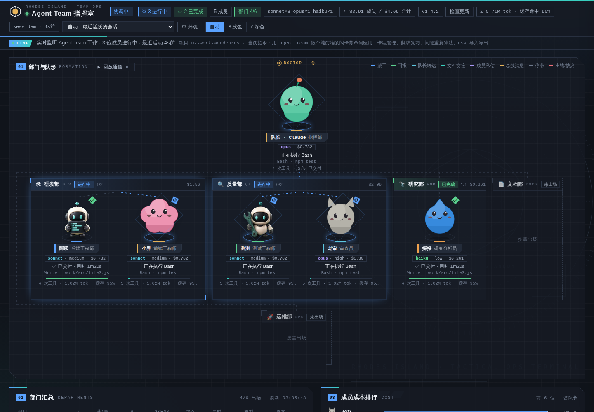

<div align="center">

# claude-agent-team

**A resident agent team for Claude Code, and a board that shows the work.**

Department roles, a file-based office protocol, and a live dashboard bound to loopback. Dispatched subagents stop being a black box that only speaks when it is finished.

[](https://github.com/another-bbzj/claude-agent-team/actions/workflows/test.yml)


[30-second start](#start) · [Why](#why) · [Guide](docs/GUIDE.en.md) · [中文](README.md)

[Contribute](CONTRIBUTING.md) · [Integrations](docs/INTEGRATIONS.md) · [Security](SECURITY.md) · [Roadmap](docs/ROADMAP.md)

</div>

<a id="start"></a>

## 30-second start

The runtime needs **Python 3.8+** and the standard library. Git is only needed to clone. The board reads Claude Code transcripts under your `~/.claude/projects/` directory. It does not call a model API. Update checks and artwork downloads run when you ask for them.

**Look at synthetic data first** (no install, no account, no personal transcripts):

```sh
git clone https://github.com/another-bbzj/claude-agent-team.git
cd claude-agent-team
python tools/demo_board.py --port 7790
```

Open <http://127.0.0.1:7790/>. See [the demo guide](docs/DEMO.md).

**Install into your Claude Code setup:**

```sh
python install.py
```

Start a new Claude Code session. A `SessionStart` hook keeps the board at <http://127.0.0.1:7788/>. Ask it to use `agent team` on a task that can be split. What the installer writes, how updates preserve your edits, and how uninstall works: [Install and update](docs/GUIDE.en.md#install).

<a id="why"></a>

## Why it exists

Claude Code can already dispatch subagents. After they leave, you cannot see which tool is running, whether two agents agreed on an interface, or what the turn roughly cost. This repository fixes three habits:

| | |
|---|---|
| **Roles** | Eight resident agents, each with a name, a job and a model tier. Saying `agent team` (also “团队”, “多代理”, “分头做”, “并行开发”) loads the team skill. |
| **Handoffs** | Spec, tickets, inboxes and handoffs live in the project’s `.team/` directory. Live notes go through `msg.py`, which appends the inbox file when the board is down. You can also write to an agent from the board. |
| **A local picture** | The browser shows departments, the current tool, progress, tokens and an estimated cost. Prices in `team-board/team.json` are **estimates, not a provider bill**. |

The side-by-side comparison and the first full task are in the guide: [before you start](docs/GUIDE.en.md#why) and [first run](docs/GUIDE.en.md#first-run). Panel-by-panel screenshots stay in the [Chinese illustrated guide](docs/GUIDE.md).



## Read next

| Goal | Where |
|---|---|
| Panels, drawer, themes, backdrop | [Guide · interface](docs/GUIDE.en.md#ui) |
| One team task, end to end | [First run](docs/GUIDE.en.md#first-run) |
| How agents message each other | [Message bus](docs/GUIDE.en.md#msg) |
| Departments, models, pets | [Members](docs/GUIDE.en.md#members) · [Artwork](docs/GUIDE.en.md#pets) |
| Third-party gateways and prices | [Providers](docs/GUIDE.en.md#providers) |
| The board will not open, or the numbers look wrong | [FAQ](docs/GUIDE.en.md#faq) |
| Aggregate export, offline Codex exec metrics | [Integrations](docs/INTEGRATIONS.md) · [Roadmap](docs/ROADMAP.md) |
| Change this repository | [CONTRIBUTING.md](CONTRIBUTING.md) · [AGENTS.md](AGENTS.md) · [Codex maintenance](docs/CODEX.md) |

The live board parses **Claude Code** sessions. [tools/codex_metrics.py](docs/CODEX_METRICS.md) summarizes an explicit `codex exec --json` log offline. It does not ingest interactive Codex sessions; that remains [planned](docs/ROADMAP.md). Using Codex to maintain this repository, and importing pets from a local Codex install, are separate.

## Release notes and questions

[CHANGELOG.md](CHANGELOG.md) is reconstructed from commits on `main`. This repository has no git tags; [`VERSION`](VERSION) is 1.4.2. [docs/FAQ.md](docs/FAQ.md) restates the questions in the guide’s [FAQ](docs/GUIDE.md#faq). The public issue list had no threads to add.

## License

[MIT](LICENSE). This is an independent community project.
