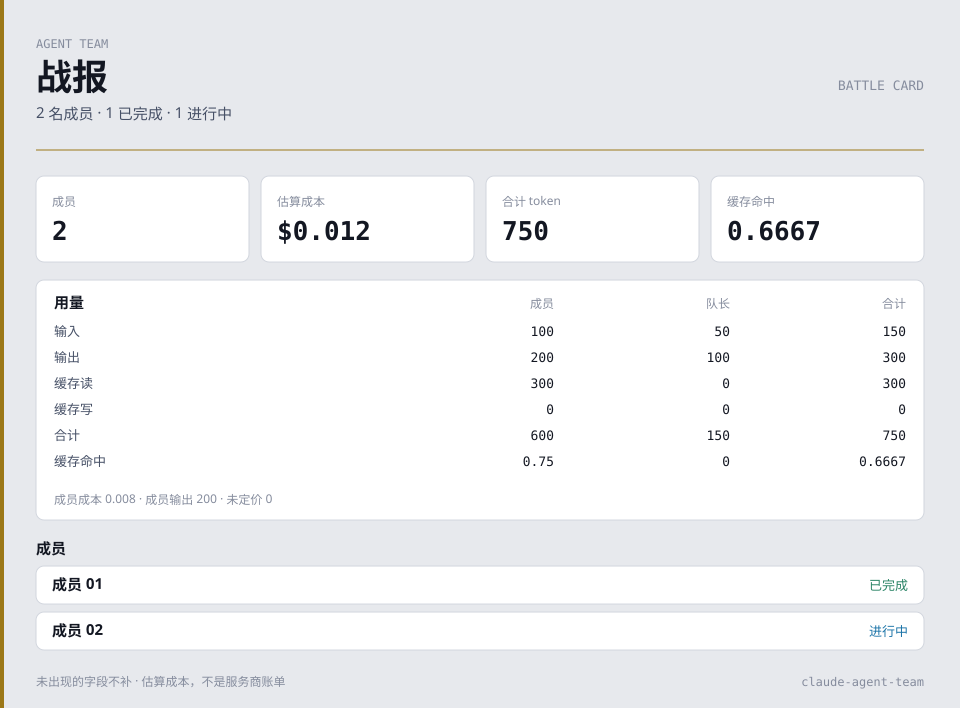

<div align="center">

# claude-agent-team

**A resident agent team for Claude Code, and a board that shows the work.**

Department roles, a file-based office protocol, and a live dashboard bound to loopback. Dispatched subagents stop being a black box that only speaks when it is finished.

[](https://github.com/another-bbzj/claude-agent-team/actions/workflows/test.yml)


[30-second start](#start) · [Why](#why) · [Guide](docs/GUIDE.en.md) · [中文](README.md)

[Contribute](CONTRIBUTING.md) · [Integrations](docs/INTEGRATIONS.md) · [Security](SECURITY.md) · [Roadmap](docs/ROADMAP.md)

</div>

<a id="start"></a>

## 30-second start

The runtime needs **Python 3.8+** and the standard library. Git is only needed to clone. The board reads Claude Code transcripts under your `~/.claude/projects/` directory. It does not call a model API. Update checks and artwork downloads run when you ask for them.

**Look at synthetic data first** (no install, no account, no personal transcripts):

```sh
git clone https://github.com/another-bbzj/claude-agent-team.git
cd claude-agent-team
python tools/demo_board.py --port 7790
```

Open <http://127.0.0.1:7790/>. See [the demo guide](docs/DEMO.md). The page includes a read-only official task board with pending, in progress and completed columns. Click a card, or press Enter, to open the read-only detail. Hover links a card to a stage member only when `owner` is that exact name. Alt-click, or the「钉」control, pins the highlight.


The same kind of snapshot can become one SVG battle card. This sample is `examples/snapshot.synthetic.json`, which has member status, tokens, cache hit and an estimated cost, and does not have names, departments or tasks:

```sh
python tools/battle_card.py --input examples/snapshot.synthetic.json --static
```



`auto` follows the system theme. Drop `--static` for a slow dash. Names, departments, elapsed time and completed tasks appear only when the snapshot has those fields. Unpriced models are marked 部分. `--session` or `--project` selects a live board session the same way `export_snapshot.py` does. A stall-alert count, theater count, or retained live-hook count is drawn only when that field is already on the snapshot. Paths, session ids, e-mail addresses, prompts and tool arguments are left out. The board button「导出战报卡」downloads the same SVG in the browser and does not upload it.

**Install into your Claude Code setup:**

```sh
python install.py
```

Start a new Claude Code session. A `SessionStart` hook keeps the board at <http://127.0.0.1:7788/>. Ask it to use `agent team` on a task that can be split. What the installer writes, how updates preserve your edits, and how uninstall works: [Install and update](docs/GUIDE.en.md#install).

Optional live hooks: `python install.py --hooks`. They report tool calls before the transcript is flushed. If the board is down, the relay exits 0 and prints nothing, so Claude Code's decision is unchanged. Fields, uninstall, and the fact that events are not merged with transcripts: [Hooks](docs/HOOKS.md). Without `--hooks`, installation stays as before.

<a id="why"></a>

## Why it exists

Claude Code can already dispatch subagents. After they leave, you cannot see which tool is running, whether two agents agreed on an interface, or what the turn roughly cost. This repository fixes three habits:

| | |
|---|---|
| **Roles** | Eight resident agents, each with a name, a job and a model tier. Saying `agent team` (also “团队”, “多代理”, “分头做”, “并行开发”) loads the team skill. |
| **Handoffs** | Spec, tickets, inboxes and handoffs live in the project’s `.team/` directory. Live notes go through `msg.py`, which appends the inbox file when the board is down. You can also write to an agent from the board. |
| **A local picture** | The browser shows departments, the current tool, progress, tokens and an estimated cost. When the selected session has `~/.claude/tasks/`, a read-only official task board sits under the department table; opening a card shows the description and dependencies. Prices in `team-board/team.json` are **estimates, not a provider bill**. A `budget` block in that file, or `--budget` at startup, adds a guard; with no budget the guard stays hidden. Near the cap it turns yellow, over the cap it turns red, and it names a lower tier from the role table. When a member or the lead is below `cacheAdvice.hitRatio` (default 0.5), the cost rank lists cache advice: a gap past the TTL, model switching, a prefix written again and again, a mid-session system prompt or tool-list change, or one-shot subagent cold starts. Each line cites the local token counts and an estimated saving. A cause the transcript does not show is left out. |

The side-by-side comparison and the first full task are in the guide: [before you start](docs/GUIDE.en.md#why) and [first run](docs/GUIDE.en.md#first-run). Panel-by-panel screenshots stay in the [Chinese illustrated guide](docs/GUIDE.md).


The overview still is the stage and departments. The read-only official task row (pending / in progress / completed) appears under the department table when the selected session has a team directory in `~/.claude/tasks/`. The schematic above uses the synthetic cards: exact owner, unowned, lead name, and a near-miss with a trailing space. Click, Enter, Alt-click and the「钉」control are on the demo page, not in the SVG.

## Read next

| Goal | Where |
|---|---|
| How the pieces connect | [Runtime](docs/GUIDE.en.md#arch) |
| Panels, drawer, themes, backdrop | [Guide · interface](docs/GUIDE.en.md#ui) |
| One team task, end to end | [First run](docs/GUIDE.en.md#first-run) |
| How agents message each other | [Message bus](docs/GUIDE.en.md#msg) |
| Departments, models, pets | [Members](docs/GUIDE.en.md#members) · [Artwork](docs/GUIDE.en.md#pets) |
| Third-party gateways and prices | [Providers](docs/GUIDE.en.md#providers) |
| The board will not open, or the numbers look wrong | [FAQ](docs/GUIDE.en.md#faq) |
| Aggregate export for one session or project, battle card, offline Codex exec metrics | [Integrations](docs/INTEGRATIONS.md) · [Roadmap](docs/ROADMAP.md) |
| Usage and estimated costs for one session or project in Prometheus / Grafana | [Prometheus textfile export and node_exporter](docs/INTEGRATIONS.md#prometheus-and-node_exporter) |
| Optional live hooks | [Hooks](docs/HOOKS.md) |
| Change this repository | [CONTRIBUTING.md](CONTRIBUTING.md) · [AGENTS.md](AGENTS.md) · [Codex maintenance](docs/CODEX.md) |

The live board parses **Claude Code** sessions. [tools/codex_metrics.py](docs/CODEX_METRICS.md) summarizes an explicit `codex exec --json` log offline. It does not ingest interactive Codex sessions; that remains [planned](docs/ROADMAP.md). Using Codex to maintain this repository, and importing pets from a local Codex install, are separate.

## Release notes and questions

[CHANGELOG.md](CHANGELOG.md) is reconstructed from commits on `main`. This repository has no git tags; [`VERSION`](VERSION) is 1.4.3. [docs/FAQ.md](docs/FAQ.md) restates the questions in the guide’s [FAQ](docs/GUIDE.md#faq). The public issue list had no threads to add.

## License

[MIT](LICENSE). This is an independent community project.
