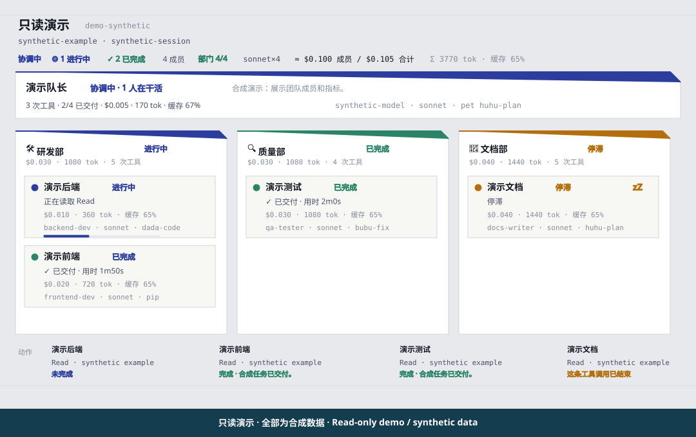
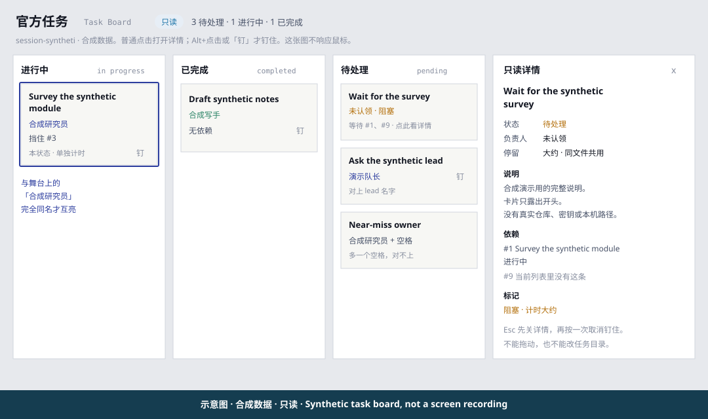
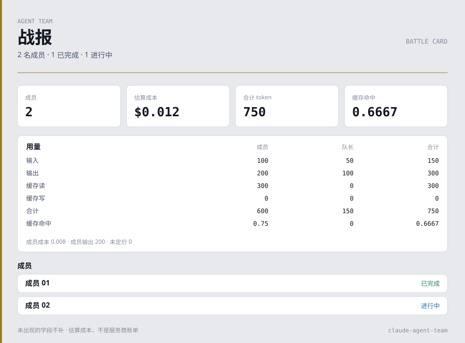
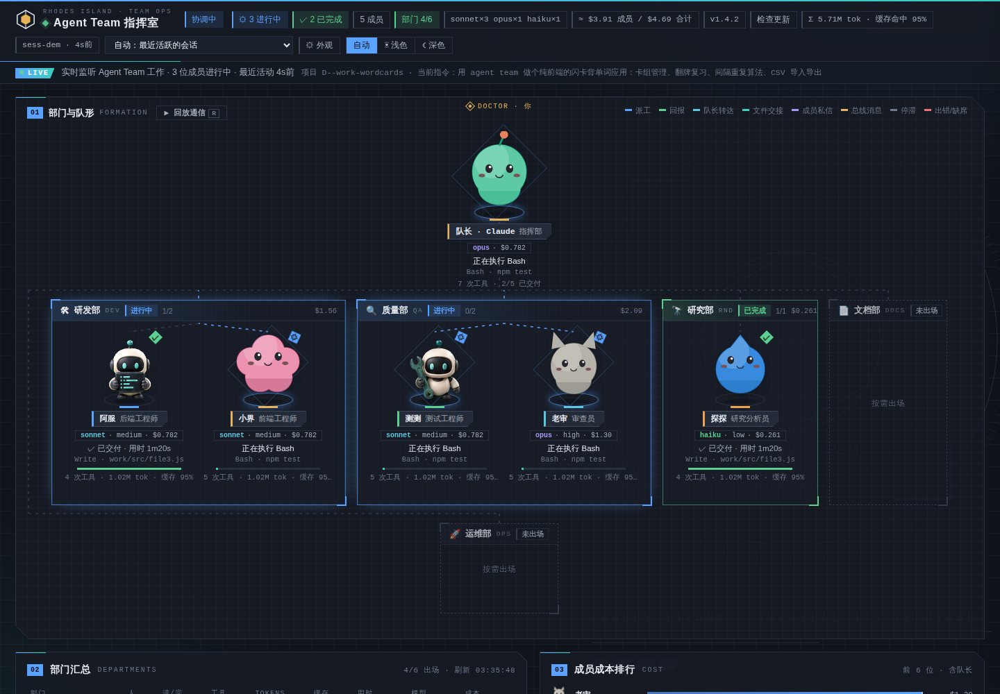

<div align="center">

# claude-agent-team

**A resident agent team for Claude Code, and a board that shows the work.**

Department roles, a file-based office protocol, and a live dashboard bound to loopback. Dispatched subagents stop being a black box that only speaks when it is finished.

[](https://github.com/another-bbzj/claude-agent-team/actions/workflows/test.yml)


[30-second start](#start) · [Compare](#compare) · [Why](#why) · [Guide](docs/GUIDE.en.md) · [中文](README.md)

[Contribute](CONTRIBUTING.md) · [Integrations](docs/INTEGRATIONS.md) · [Security](SECURITY.md) · [Roadmap](docs/ROADMAP.md)

</div>

<a id="compare"></a>

## Compare

The cells below are limited to facts checked against public pages on 2026-11-05.

| Tool | Positioning | Install / runtime | Visualization | Open source? |
|---|---|---|---|---|
| **[claude-agent-team](https://github.com/another-bbzj/claude-agent-team)** | A local, zero-dependency board. Estimated cost by member and department, transcripts plus optional hooks, and a battle card or offline replay | Python 3.8+ and the standard library. The board binds to `127.0.0.1` and does not call a model API | A browser view of departments, the current tool, tokens, and estimated cost; an SVG battle card; a single-file HTML replay | [MIT](LICENSE) |
| **[Official Agent Teams](https://code.claude.com/docs/en/agent-teams)** | Experimental. One lead coordinates independent sessions that share tasks and message each other | Off by default. Set `CLAUDE_CODE_EXPERIMENTAL_AGENT_TEAMS=1`. [One team per session, and task status can lag](https://code.claude.com/docs/en/agent-teams). [Teammates are not isolated in git worktrees](https://code.claude.com/docs/en/agents) | An agent panel in the lead’s terminal, or tmux / iTerm2 split panes | No. The Claude Code repo’s [LICENSE.md](https://github.com/anthropics/claude-code/blob/main/LICENSE.md) says “All rights reserved” |
| **[Claude Squad](https://github.com/smtg-ai/claude-squad)** | One terminal for parallel local agents, including Claude Code, Codex, Gemini, and Aider | Homebrew or the repo install script. The command is `cs`. Requires tmux and gh. Each task gets a git worktree | A single-window TUI with a preview tab and a diff tab | [AGPL-3.0](https://github.com/smtg-ai/claude-squad/blob/main/LICENSE.md) |
| **[Conductor](https://www.conductor.build/docs)** | A macOS app. Runs Claude Code, Codex, Cursor, and OpenCode in parallel. Each task gets a workspace | [macOS only](https://www.conductor.build/docs/installation). Creating a workspace [creates a git worktree and checks out a branch](https://www.conductor.build/docs/concepts/git-worktrees). The site also offers [isolated cloud sandboxes](https://www.conductor.build/) | In the app: [chats and diffs](https://www.conductor.build/docs/concepts/git-worktrees), then [review, open a pull request, and merge](https://www.conductor.build/docs) | Proprietary (the terms use that word). The client may include open-source components; the list is available on request. [Terms](https://www.conductor.build/terms) |

This repository is the local visualization, estimated-cost, and acceptance layer on top of Claude Code teams and subagents; it is not a framework or a session multiplexer.

<a id="start"></a>

## 30-second start

The runtime needs **Python 3.8+** and the standard library. Git is only needed to clone. The board reads Claude Code transcripts under your `~/.claude/projects/` directory. It does not call a model API. Update checks and artwork downloads run when you ask for them.

**Look at synthetic data first** (no install, no account, no personal transcripts):

```sh
git clone https://github.com/another-bbzj/claude-agent-team.git
cd claude-agent-team
python tools/demo_board.py --port 7790
```

Open <http://127.0.0.1:7790/>. See [the demo guide](docs/DEMO.md). The page includes a read-only official task board with pending, in progress and completed columns. Click a card, or press Enter, to open the read-only detail. Hover links a card to a stage member only when `owner` is that exact name. Alt-click, or the「钉」control, pins the highlight. The synthetic cast includes a passing test, a failing test and an unknown one. A failed card turns red. The badge jumps to that row in the activity feed.

To skip Python, open [`docs/site/index.html`](docs/site/index.html) in a browser. The same synthetic snapshot is embedded in the file and works offline. The GitHub Pages URL is <https://another-bbzj.github.io/claude-agent-team/>. If that URL 404s, a maintainer sets Settings → Pages → Build and deployment → Source to GitHub Actions once.





The same kind of snapshot can become one SVG battle card. This sample is `examples/snapshot.synthetic.json`, which has member status, tokens, cache hit and an estimated cost, and does not have names, departments or tasks:

```sh
python tools/battle_card.py --input examples/snapshot.synthetic.json --static
```



`auto` follows the system theme. Drop `--static` for a slow dash. Names, departments, elapsed time and completed tasks appear only when the snapshot has those fields. Unpriced models are marked 部分. `--session` or `--project` selects a live board session the same way `export_snapshot.py` does. A stall-alert count, theater count, or retained live-hook count is drawn only when that field is already on the snapshot. Paths, session ids, e-mail addresses, prompts and tool arguments are left out. The board button「导出战报卡」downloads the same SVG in the browser and does not upload it.

The same snapshot can also become one offline HTML replay. Open the file directly. It does not start the board or load a remote script. The embedded copy keeps member cards, tool labels and key messages after redaction. Aggregate totals appear only when the snapshot already has a totals block `export_metrics` accepts.

```sh
python tools/export_replay.py --demo -o replay.html
```

The demo reads `examples/board-demo.synthetic.json`. Read a real-session file before sharing it. See [INTEGRATIONS.md](docs/INTEGRATIONS.md).

`python tools/retro_report.py --demo` writes a Markdown retrospective from the synthetic demo snapshot. It keeps only timestamps, estimated cost and blockers that are already present, and marks a missing price 部分 or 未知.

**Install into your Claude Code setup:**

```sh
python install.py
```

Start a new Claude Code session. A `SessionStart` hook keeps the board at <http://127.0.0.1:7788/>. Ask it to use `agent team` on a task that can be split. `agents/team-lead.md` is the lead playbook. When `CLAUDE_CODE_EXPERIMENTAL_AGENT_TEAMS=1` in an interactive session, the lead uses official teammates and a shared task list, and copies each ticket's acceptance lines into fields the board already reads. Otherwise it keeps the subagent flow. Official teams do not put teammates in separate git worktrees; see [AGENT_TEAMS.md](docs/AGENT_TEAMS.md) and [WORKTREES.md](docs/WORKTREES.md). What the installer writes, how updates preserve your edits, and how uninstall works: [Install and update](docs/GUIDE.en.md#install).

Optional live hooks: `python install.py --hooks`. They report tool calls before the transcript is flushed. If the board is down, the relay exits 0 and prints nothing, so Claude Code's decision is unchanged. Fields, uninstall, and the fact that events are not merged with transcripts: [Hooks](docs/HOOKS.md). Without `--hooks`, installation stays as before.

<a id="why"></a>

## Why it exists

Claude Code can already dispatch subagents. After they leave, you cannot see which tool is running, whether two agents agreed on an interface, or what the turn roughly cost. This repository fixes three habits:

| | |
|---|---|
| **Roles** | Eight resident teammates, each with a name, a job and a model tier, plus a `team-lead` playbook for the main session. Saying `agent team` (also “团队”, “多代理”, “分头做”, “并行开发”) loads the team skill. |
| **Handoffs** | Spec, tickets, inboxes and handoffs live in the project’s `.team/` directory. Live notes go through `msg.py`, which appends the inbox file when the board is down. You can also write to an agent from the board. |
| **A local picture** | The browser shows departments, the current tool, progress, tokens and an estimated cost. A test command from the transcript shows up on the member card and the task card as pass, fail or unknown. Truncated or unrecognized output stays unknown. A failed card turns red, and the badge jumps to that activity row. When the selected session has `~/.claude/tasks/`, a read-only official task board sits under the department table; opening a card shows the description and dependencies. The same result is copied onto an official task only when `owner` is that member's exact name. When that session directory is a git checkout, a task card also shows how many tracked files and lines changed while the task was in progress, or the branch diff when the task has no clock. `.team` tickets use the files they name. Git is read-only; if it is missing or the directory is not a repository, the card leaves the count off instead of showing zero. Prices in `team-board/team.json` are **estimates, not a provider bill**. A `budget` block in that file, or `--budget` at startup, adds a guard; with no budget the guard stays hidden. Near the cap it turns yellow, over the cap it turns red, and it names a lower tier from the role table. When a member or the lead is below `cacheAdvice.hitRatio` (default 0.5), the cost rank lists cache advice: a gap past the TTL, model switching, a prefix written again and again, a mid-session system prompt or tool-list change, or one-shot subagent cold starts. Each line cites the local token counts and an estimated saving. A cause the transcript does not show is left out. |

The side-by-side comparison and the first full task are in the guide: [before you start](docs/GUIDE.en.md#why) and [first run](docs/GUIDE.en.md#first-run). Panel-by-panel screenshots stay in the [Chinese illustrated guide](docs/GUIDE.md).



The overview still is the stage and departments. The read-only official task row (pending / in progress / completed) appears under the department table when the selected session has a team directory in `~/.claude/tasks/`. The schematic above uses the synthetic cards: exact owner, unowned, lead name, and a near-miss with a trailing space. Click, Enter, Alt-click and the「钉」control are on the demo page, not in the SVG.

## Read next

| Goal | Where |
|---|---|
| How the pieces connect | [Runtime](docs/GUIDE.en.md#arch) |
| Panels, drawer, themes, backdrop | [Guide · interface](docs/GUIDE.en.md#ui) |
| One team task, end to end | [First run](docs/GUIDE.en.md#first-run) |
| Generate owned tickets, inboxes and dependency waves from JSON | [Offline workspace helper](docs/WORKSPACE.md) |
| How agents message each other | [Message bus](docs/GUIDE.en.md#msg) |
| Departments, models, pets | [Members](docs/GUIDE.en.md#members) · [Artwork](docs/GUIDE.en.md#pets) |
| Third-party gateways and prices | [Providers](docs/GUIDE.en.md#providers) |
| The board will not open, or the numbers look wrong | [FAQ](docs/GUIDE.en.md#faq) |
| Aggregate export for one session or project, battle card, offline Codex exec metrics | [Integrations](docs/INTEGRATIONS.md) · [Roadmap](docs/ROADMAP.md) |
| Usage and estimated costs for one session or project in Prometheus / Grafana | [Prometheus textfile export and node_exporter](docs/INTEGRATIONS.md#prometheus-and-node_exporter) |
| Optional live hooks | [Hooks](docs/HOOKS.md) |
| Change this repository | [CONTRIBUTING.md](CONTRIBUTING.md) · [AGENTS.md](AGENTS.md) · [Codex maintenance](docs/CODEX.md) |

The board discovers **Claude Code and Codex** sessions. Switch provider in the header to see measured models, members, tools and read-only conversation. See [Codex sessions](docs/CODEX_SESSIONS.md) and [wallpaper import](docs/WALLPAPER_IMPORT.md). The existing [exec metrics tool](docs/CODEX_METRICS.md) remains a separate offline adapter.

| Source | Where it is read | What the board maps | Left out |
|---|---|---|---|
| Claude Code transcripts | `~/.claude/projects` | Members, tool calls, tokens, estimated cost, official tasks | Model APIs |
| Codex CLI rollouts | JSONL under `~/.codex/sessions` | Members, plan or todo tasks, tool calls, cumulative tokens, and an estimated cost when the price table knows the model | `.jsonl.zst`, archived sessions, reasoning text, raw tool output, the subscription bill |
| `codex exec` JSONL | Only a file you pass in | An offline summary, not the live board | Interactive sessions |

## Release notes and questions

[CHANGELOG.md](CHANGELOG.md) is reconstructed from commits on `main`. This repository has no git tags; [`VERSION`](VERSION) is 1.4.3. Before publishing, run `python tools/release_check.py`. It checks that `VERSION` matches the latest changelog section, that the unreleased section has notes, that scripts cited in the READMEs exist, that the static site matches `build_pages_site.py --check`, and that tests can be discovered. It does not create a tag or a GitHub Release. See [the release checklist](docs/RELEASE_CHECKLIST.md). [docs/FAQ.md](docs/FAQ.md) restates the questions in the guide’s [FAQ](docs/GUIDE.md#faq). The public issue list had no threads to add.

## License

[MIT](LICENSE). This is an independent community project.
