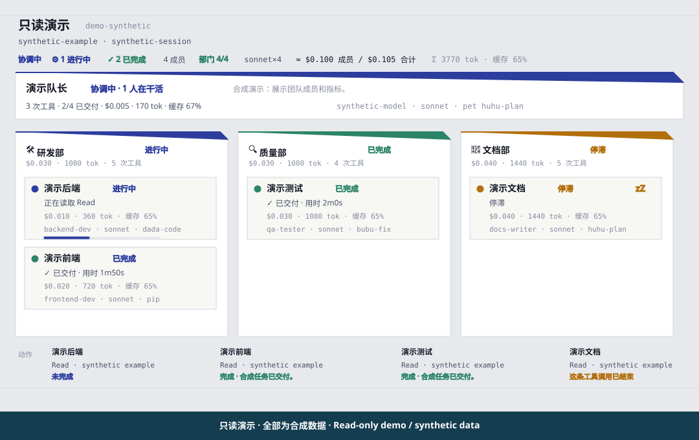

<div align="center">

# claude-agent-team

**让 Claude Code 像一家小公司一样干活，而且你能看见它在干活。**

常驻的分部门 Agent、写在项目里的办公协议，加上只绑定本机回环地址的实时看板。子代理派出去之后，不再是一个等到最后才响的黑盒。

[](https://github.com/another-bbzj/claude-agent-team/actions/workflows/test.yml)


[30 秒开始](#start) · [为什么](#why) · [图文手册](docs/GUIDE.md) · [English](README.en.md)

[参与贡献](CONTRIBUTING.md) · [集成](docs/INTEGRATIONS.md) · [用 Codex 维护](docs/CODEX.md) · [路线图](docs/ROADMAP.md) · [安全反馈](SECURITY.md)

</div>

<a id="start"></a>

## 30 秒开始

运行时只要 **Python 3.8+ 标准库**。看板读本机 `~/.claude/projects/` 的转录，不调用模型 API。检查更新和下载形象都要你自己触发。

**先看合成数据**（不安装，不读你的会话）：

```bash
git clone https://github.com/another-bbzj/claude-agent-team.git
cd claude-agent-team
python tools/demo_board.py --port 7790
```

打开 <http://127.0.0.1:7790/>。数据来自仓库里的合成快照，见 [演示说明](docs/DEMO.md)。



**装进自己的 Claude Code：**

```bash
python install.py
```

新开一个会话。SessionStart 钩子会把看板留在后台：<http://127.0.0.1:7788/>。然后说「用 agent team」，让它做一件至少拆得开的事。安装写到哪、怎么更新、怎么卸载，见 [安装与更新](docs/GUIDE.md#install)。

<a id="why"></a>

## 为什么需要它

Claude Code 自己会派子代理。派出去之后，谁在调用什么工具、两个人有没有对上接口、这次大概花了多少，都要等到最后一句「完成了」。这个仓库把三件事固定下来：

| | |
|---|---|
| **分工** | 8 位常驻成员，各带名字、职责和模型档位。说「用 agent team」（「团队」「多代理」「分头做」「并行开发」也行）就按技能上岗。 |
| **协作** | 契约、工单、收件箱、交接单写在项目的 `.team/`。即时的话走 `msg.py`；看板没开时，退回追加收件箱文件。你也可以在看板上直接发话。 |
| **可见** | 浏览器里看部门、当前工具、进度、token 和估算成本。单价在 `team-board/team.json`，**是估算，不是服务商账单**。 |

和「每次临时描述角色」的逐项对照、第一次任务从定规模到验收的走法，在 [开工之前](docs/GUIDE.md#why) 和 [第一次使用](docs/GUIDE.md#first-run)。


<div align="center"><sub>队长在上，各部门分组；飞线是派工、回报、留言和交接。每个面板的说明在 <a href="docs/GUIDE.md#ui">图文手册</a>。</sub></div>

## 接着读

| 你想做的 | 去哪 |
|---|---|
| 看运行时怎么接在一起 | [运行时结构](docs/GUIDE.md#arch) |
| 看懂顶栏、舞台、通讯、抽屉、外观 | [界面](docs/GUIDE.md#ui) |
| 走完一次团队任务 | [第一次使用](docs/GUIDE.md#first-run) |
| 看成员怎么互相发消息 | [消息总线](docs/GUIDE.md#msg) |
| 加部门、换模型、换桌宠 | [成员](docs/GUIDE.md#members) · [形象](docs/GUIDE.md#pets) |
| 第三方网关和估价 | [第三方 API](docs/GUIDE.md#providers) |
| 看板打不开、部门空着、数字对不上 | [常见问题](docs/GUIDE.md#faq) |
| 发布记录和按主题整理的问答 | [CHANGELOG](CHANGELOG.md) · [FAQ](docs/FAQ.md) |
| 只读导出、Codex exec 离线指标 | [集成](docs/INTEGRATIONS.md) · [路线图](docs/ROADMAP.md) |
| 改这个仓库 | [CONTRIBUTING.md](CONTRIBUTING.md) · [AGENTS.md](AGENTS.md) · [Codex 维护](docs/CODEX.md) |

看板当前解析的是 **Claude Code** 会话。`tools/codex_metrics.py` 只离线汇总你指定的 `codex exec --json` 日志，不把 Codex 交互会话画进看板。交互会话的适配还在 [路线图](docs/ROADMAP.md) 里。

## 参与

缺陷请用 [缺陷表单](https://github.com/another-bbzj/claude-agent-team/issues/new?template=bug_report.yml)，功能请用 [建议表单](https://github.com/another-bbzj/claude-agent-team/issues/new?template=feature_request.yml)。不要附真实转录、密钥、本机路径或下载的形象。安全问题走 [SECURITY.md](SECURITY.md)。

思路借鉴 [cc-haha](https://github.com/NanmiCoder/cc-haha) 的 Agent Teams 工作台；省 token 的写法借鉴 [ponytail](https://github.com/DietrichGebert/ponytail) 与 [mattpocock/skills](https://github.com/mattpocock/skills)。桌宠格式与 Codex、[petdex](https://petdex.dev) 兼容，感谢社区作者们的形象。

## 许可证
[MIT](LICENSE) © [another-bbzj](https://github.com/another-bbzj)
