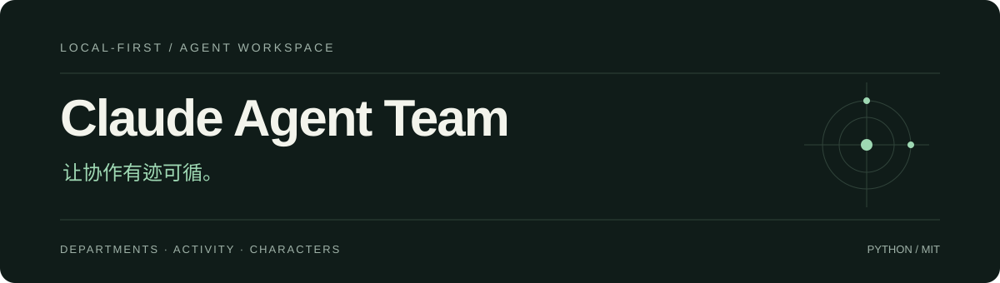
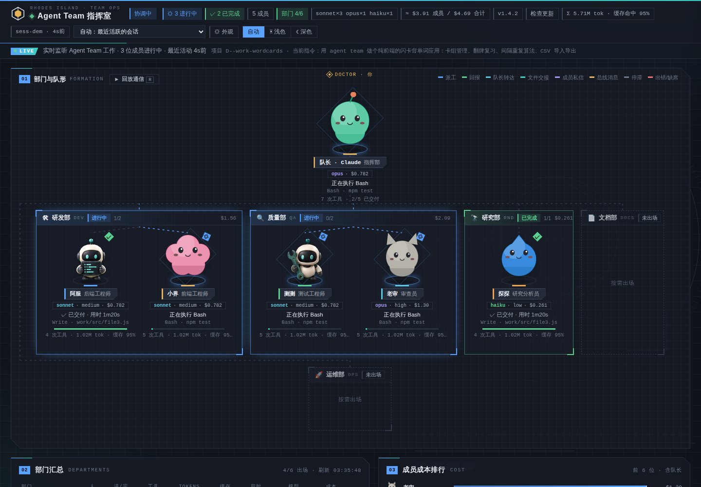

<div align="center">

<picture>
  <source media="(prefers-color-scheme: light)" srcset="docs/img/readme-cover-light.svg">
  
</picture>

**把正在工作的 Agent，变成一支看得见的团队。**

部门分工 · 实时活动 · 角色动画 · 用量与估算成本

[快速开始](#start) · [认识小队](#characters) · [图文手册](docs/GUIDE.md) · [English](README.en.md)

[](https://github.com/another-bbzj/claude-agent-team/actions/workflows/test.yml)
[](LICENSE)

</div>

Claude Agent Team 为 Claude Code 提供部门制成员、项目协作协议和本机实时看板，也能只读查看 Codex 会话。你可以看到谁在工作、正在调用什么工具、测试是否通过，以及这次协作的用量和估算成本。

运行时仅需 **Python 3.8+ 标准库**，支持 Windows、macOS 和 Linux。看板绑定本机回环地址，不调用模型 API。

<a id="characters"></a>

## 认识你的小队


| 角色 | 形象与定位 |
|---|---|
| **星澜 · 战术工程师** | 工程装备与工具，负责研发现场的视觉形象 |
| **绮星 · 界面设计师** | 粉发、贝雷帽与画板，偏爱界面和细节 |
| **曜宁 · 策略领航员** | 银发与青绿配色，梳理方向和任务 |
| **墨巡 · 数据分析员** | 深发与琥珀配色，观察、研究与核对 |
| **橙羽 · 发布工程师** | 橙发与工作服，陪伴构建和交付 |

角色会随待机、移动、工作、审阅等状态切换动画。点开成员抽屉即可换装，既可以只改当前成员，也可以保存为岗位形象。已有的手动分配优先保留；角色形象只影响看板展示，不改变 Agent 的能力或模型。

五位原创角色随仓库提供，也可以导入自己的精灵图或兼容的桌宠包。[形象格式与导入说明 →](docs/GUIDE.md#pets)

<a id="start"></a>

## 快速开始

### 先看看它如何工作

```bash
git clone https://github.com/another-bbzj/claude-agent-team.git
cd claude-agent-team
python tools/demo_board.py --port 7790
```

打开 [本机演示](http://127.0.0.1:7790/)。这是一份**只读合成数据**演示，不安装，也不读取你的真实会话。

还可以访问 [在线演示](https://another-bbzj.github.io/claude-agent-team/)，或下载仓库后直接用浏览器打开 [`docs/site/index.html`](docs/site/index.html)。若在线页面尚未启用，维护者可在仓库 Settings → Pages 中将发布来源设为 **GitHub Actions**。详情见 [演示说明](docs/DEMO.md)。

### 接入自己的 Claude Code

在仓库目录运行：

```bash
python install.py
```

新开 Claude Code 会话后，SessionStart 钩子会启动 [本机看板](http://127.0.0.1:7788/)。给它一项适合拆分的任务，例如：

> 用 agent team 做这个功能，先明确接口，再分头实现和测试。

安装会复制成员与技能，并合并 Claude Code 配置。安装位置、更新和卸载方式见 [安装指南](docs/GUIDE.md#install)。需要更及时的工具活动时，可选运行 `python install.py --hooks`，见 [实时钩子](docs/HOOKS.md)。

### 查看 Codex 会话

也可以从仓库直接启动看板：

```bash
python team-board/team_board.py --source all --port 7788
```

顶栏可切换 Claude Code 和 Codex 来源。Codex 适配读取本机日志，展示实际模型、成员、工具活动和可见对话；它不启动 Codex、不向聊天发送消息，也不修改 Codex 配置。[支持范围与限制 →](docs/CODEX_SESSIONS.md)

## 从派工到交付，都有线索

| 你关心的事 | 看板提供什么 |
|---|---|
| **谁负责什么** | 按部门排列成员，显示当前状态、任务与工具活动；项目内的 `.team/` 保存契约、工单、收件箱与交接单 |
| **任务推进到哪了** | 与当前 Claude 会话匹配的官方任务看板，包含负责人、依赖和阻塞；任务详情只读 |
| **结果是否可信** | 测试通过、失败或未知徽章；可以定位到对应动作，不把缺失或截断的输出当作成功 |
| **花了多少** | 成员与部门的 token、缓存命中和估算成本；可配置预算提示，缺少定价时明确标记 |
| **如何复盘** | 导出 SVG 战报卡、单文件 HTML 回放或 Markdown 复盘，便于离线查看与分享 |

<details>
<summary>查看看板界面</summary>



截图用于说明界面结构，展示的数据不代表用量基准。角色阵容与当前版本可能不同。[完整界面指南 →](docs/GUIDE.md#ui)

</details>

例如，把仓库的合成数据导出为离线回放：

```bash
python tools/export_replay.py --demo -o replay.html
```

用浏览器打开生成的文件即可。更多导出方式见 [集成指南](docs/INTEGRATIONS.md)。

## 按自己的习惯配置

成员、部门、价格表与缓存诊断设置在 `team-board/team.json`。看板支持添加成员、调整角色形象和导入壁纸；更新时保留用户自定义配置与素材。具体操作见 [成员管理](docs/GUIDE.md#members) 和 [壁纸导入](docs/WALLPAPER_IMPORT.md)。

**成本是估算，不是服务商账单。** 价格由本地配置决定。真实看板包含对话和本机元数据，请在分享前检查导出内容；不要公开原始转录或快照。社区桌宠只下载到自己的机器，仓库不代为分发未获授权的素材。

## 深入了解

| 想做什么 | 从这里开始 |
|---|---|
| 走完第一次团队任务 | [图文手册](docs/GUIDE.md) · [常见问题](docs/FAQ.md) |
| 从计划生成工单与依赖波次 | [离线工作区生成器](docs/WORKSPACE.md) |
| 对接导出、回放或监控 | [集成指南](docs/INTEGRATIONS.md) · [实时钩子](docs/HOOKS.md) |
| 理解 Codex 适配 | [Codex 会话](docs/CODEX_SESSIONS.md) · [用 Codex 维护](docs/CODEX.md) |
| 了解版本与后续方向 | [变更记录](CHANGELOG.md) · [路线图](docs/ROADMAP.md) |

## 参与开发

`agents/` 定义常驻成员，`skills/` 存放协作协议，`team-board/` 是看板运行时，`tools/` 提供演示与导出，`tests/` 使用合成数据和临时目录验证行为。

```bash
python -m unittest discover -s tests -v
```

发版前在同一目录运行 `python tools/release_check.py`。它核对版本号、变更记录、本文引用的脚本、静态站和测试能否被发现；失败时退出码不是 0。不打 tag，也不发布。步骤和兼容性声明的边界见 [发版检查清单](docs/RELEASE_CHECKLIST.md)。

修改前阅读 [贡献指南](CONTRIBUTING.md) 与 [AGENTS.md](AGENTS.md)。缺陷与建议可通过 [Issues](https://github.com/another-bbzj/claude-agent-team/issues) 提交，安全问题请遵循 [SECURITY.md](SECURITY.md)。

看板通过 Python 服务读取本机转录，整理为快照，再由浏览器绘制成员、任务和活动；可选钩子补充实时事件。团队协作协议写在项目文件中，与可视化层分开。[运行时结构 →](docs/GUIDE.md#arch)

## 致谢与许可

团队工作台思路参考 [cc-haha](https://github.com/NanmiCoder/cc-haha)，协作提示写法参考 [ponytail](https://github.com/DietrichGebert/ponytail) 与 [mattpocock/skills](https://github.com/mattpocock/skills)。感谢桌宠社区作者的创作。

[MIT](LICENSE) © [another-bbzj](https://github.com/another-bbzj)
