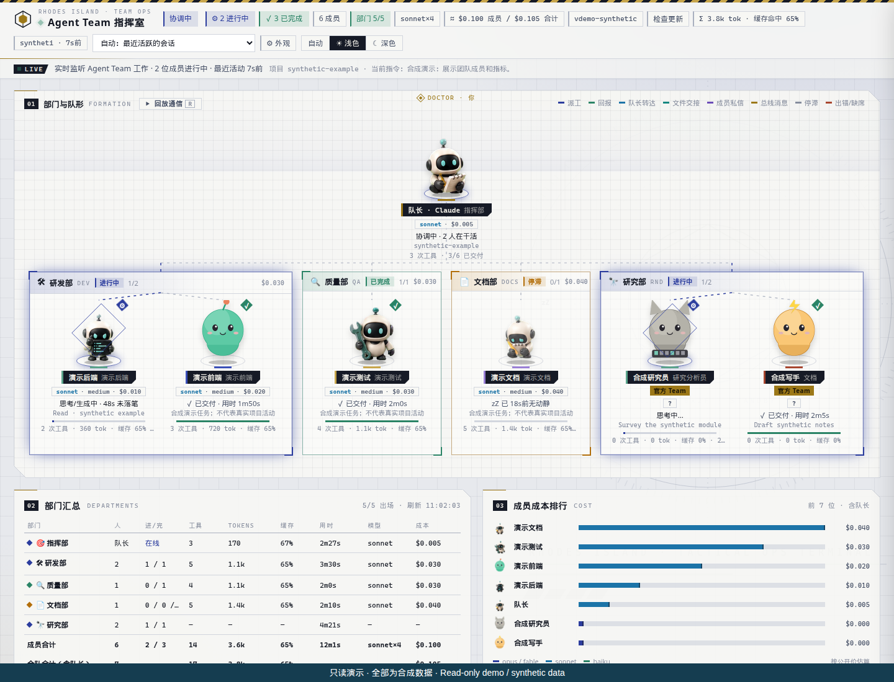
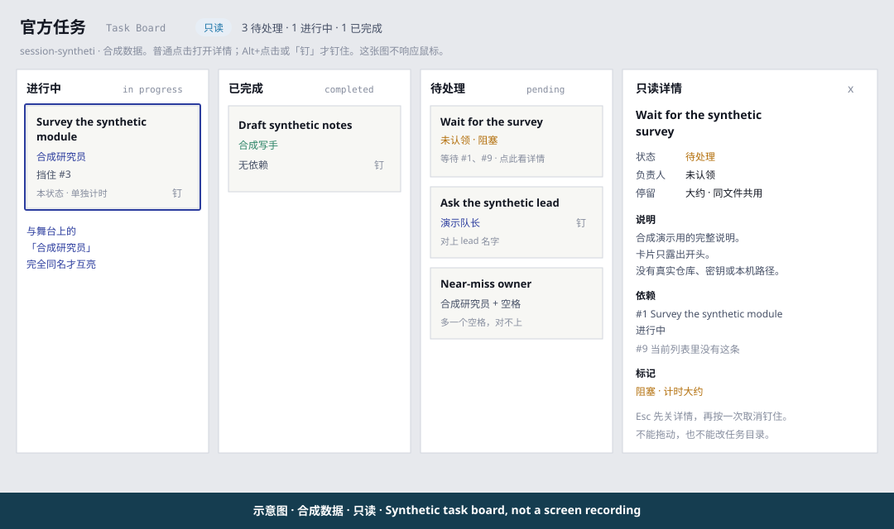

# Try the read-only synthetic board

Try the existing board interface without a Claude Code account, transcripts or an
installation. From a repository checkout with Python 3.8 or later:

```sh
python tools/demo_board.py --port 7790
```

Open [the local demo](http://127.0.0.1:7790/) in your browser. The command prints the
actual URL; `--port 0` chooses an available port. Stop it with Ctrl+C. It does not
open a browser automatically or install anything into your home directory.

To see a red budget guard on the same synthetic cast, add `--budget-alert` or open
`http://127.0.0.1:7790/?budget=over`. The session cap is half of the fixture total, so
the bar is already over; the synthetic docs member is on sonnet while the role table
says haiku, so the panel includes a downgrade line. The default command sets no budget
and the panel stays hidden. The numbers are still the example scenario, not a bill.

The page displays four synthetic subagent members and two official Agent Team
teammates, plus coherent example departments, tool activity, token counts and
estimated costs. Official teammates are marked with a 官方 Team badge. When the
fixture includes `officialTeam.tasks`, the page also shows a read-only kanban with
pending, in progress and completed columns (owner, dependencies or blocked, and
time in the current state). Clicking a card opens a read-only detail drawer; at
least one synthetic task has a full description so that drawer can be opened
offline. Hover or focus a card to light the stage member whose name is an exact
match, or hover a member to light that person's tasks. Tasks with no owner, and
one owner that only differs by a trailing space, stay unchanged; tasks owned by
someone else dim. A plain click opens the drawer and does not pin. Alt-click, or
the「钉」control on a matched card, pins that exact name; doing it again clears
the pin. Esc closes the drawer first, then clears the pin. Above the columns are
four filters: 全部, 阻塞中, 未对上人, and 已对上. A filter only hides cards. The
heading counts still include every task. The choice stays in this tab's
`sessionStorage`, keyed by session id and team name, and is not written to the
fixture. If a pinned name has no visible card, the pin clears. Hovering, focusing,
or opening a card draws arcs to dependencies still visible after the current filter:
unfinished prerequisites are emphasized, completed ones are fainter, a filtered-out
card is not an endpoint, and clicking an arc opens that card without changing the pin.
The schematic does not draw these chips or the arcs. A persistent banner marks it as a
**read-only demo with synthetic data**. All data comes from
[the synthetic fixture](../examples/board-demo.synthetic.json); displayed times
are shifted in memory so the example remains readable. The example is a fixed
scenario, not live work or evidence of project adoption. Its numbers are not a
benchmark or a real bill. The kanban in this demo does not read `~/.claude/tasks/`.

The same fixture includes one synthetic worktree theater, `synthetic-repo`, with branches
`main` and `worktree-feature-board`. The strip under the mission line lists both.
Choosing the other branch updates that label only; the member cards stay the one
example team. How live transcripts are grouped is [WORKTREES.md](WORKTREES.md).

The synthetic member 演示文档 is stalled on purpose. The fixture clock is 15 minutes
after that member's last event (a finished `Read`, then silence). The stall alert
threshold defaults to **10 minutes** (`600` seconds; `--stall-alert` on the live
board, or the minutes field on the alert bar). Opening this demo therefore shows
one alert: a header count, a `(1)` prefix on the tab title, a badge on the
favicon, and a bar under the mission line. 「知道了」dismisses that episode in
this browser until the activity timestamp changes; clear
`localStorage['team-board-stall-dismissed']` to see it again. Esc still closes
the task detail and then clears a pinned highlight before it collapses this
bar, so the kanban shortcut keeps working while the alert is open. Quiet mode defaults
to off. Turning it on keeps the count but does not auto-open the bar or post a
desktop notification. The page does not call `Notification.requestPermission`
on load — only the「桌面通知」button does, and only after a click. Running and
finished members are not alerted. An idle or errored member with no
`lastActivityAt` and no event timestamp is not alerted either.

The demo serves the existing `team-board/index.html`, the fixture snapshot and
only the shipped sprite/favicon allowlist. It never imports the live backend,
reads a personal `~/.claude` or `~/.codex`, scans local transcripts, downloads
artwork, checks for updates, or connects to an external API. It binds only to
`127.0.0.1`. No authentication or API key is required.

You can inspect members and switch themes. Editing, sending messages, importing
artwork, updating and shutdown API actions are unavailable: every mutation request
returns a read-only error. Some management dialogs belong to the full board and
cannot be used in this demo. Raw API endpoints other than `/snapshot.json` are
unavailable. The demo does not use the full board's `?demo=1` overlay and redirects
that URL back to `/`, avoiding duplicate synthetic members.

To share a screenshot, keep the synthetic-data banner visible and describe it as
a demonstration. For the real transcript-based workflow, follow the
[main README](../README.md). For aggregate exports and other integrations, see
[INTEGRATIONS.md](INTEGRATIONS.md).



The animation below draws the same fixture's four synthetic subagent members. It is not a screen recording. Names, status, costs and tool labels are the fields in `examples/board-demo.synthetic.json`, formatted with the board's own cost and duration rules. The numbers are the example scenario, not a benchmark or a bill. A `Read` call can be finished while the member is still stalled: that is how this fixture is written. That read sits 15 minutes before the fixture clock, which is past the 10 minute stall-alert default. This animation does not draw the two official teammates or the task kanban.

The five synthetic task cards, including the blocked task's read-only detail and the exact-name highlight, are drawn in the schematic under the animation. That SVG does not respond to the pointer. Click, Enter, Alt-click and the「钉」control work on the live demo page.



