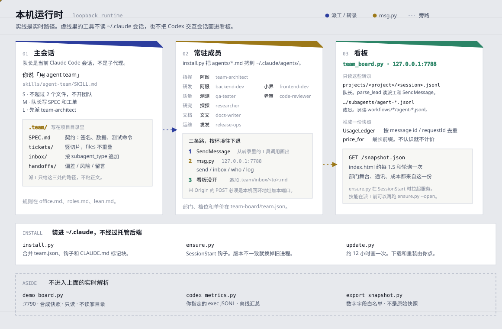
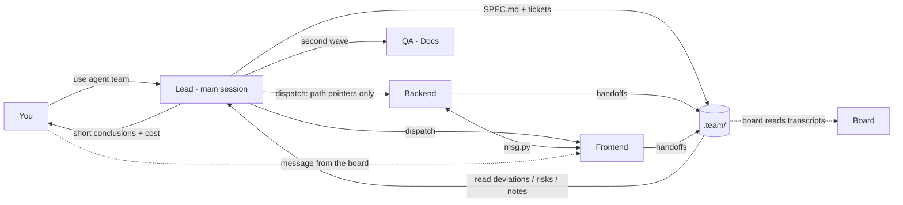

# Guide

The Chinese illustrated manual, with screenshots, is [GUIDE.md](GUIDE.md). This page is the English operational guide: everything the English landing page used to spell out, plus the install, office, messaging and troubleshooting detail that lives in the Chinese manual.

Board: <http://127.0.0.1:7788/> after installation. The `SessionStart` hook starts it; `python ~/.claude/team-board/ensure.py` starts it by hand.

## Contents

- [Before you start](#why)
- [Install, update, uninstall](#install)
- [First run](#first-run)
- [How the pieces connect](#arch)
- [How the team collaborates](#office)
- [Messages](#msg)
- [What the board shows](#ui)
- [Built-in members](#members)
- [Your own departments and members](#custom)
- [Pets](#pets)
- [Backdrop](#look)
- [Third-party APIs](#providers)
- [Token habits](#tokens)
- [Configuration and privacy](#privacy)
- [Tests and source map](#tests)
- [FAQ](#faq)
- [Ecosystem](#ecosystem)

<a id="why"></a>

## Before you start

```
You: use agent team to build a vocabulary web app

Lead (main session): pick a size → write the SPEC → split tickets → put the board link in the reply
   ├─ Dev      backend writes the data layer, frontend writes the UI     (in parallel)
   ├─ QA       tester writes tests, reviewer checks the seams             (second wave)
   ├─ Docs     writer updates the README
   └─ The lead runs the tests, walks the main path, and reports each result plus the estimated cost
```

| | Without it | With it |
|---|---|---|
| Roles | Re-describe “you are backend, you are QA” every time | Eight resident members with names, jobs and model tiers. “Use agent team” sends them on shift |
| Coordination | Subagents cannot rely on a private channel; interfaces get guessed | `msg.py` plus tickets, inboxes and handoffs. You can also message any member from the board |
| Visibility | Wait for the last “done” | A live room: sprite, current tool, progress, tokens, estimated cost, department totals, a chat-style channel, communication replay |
| Cost | The strongest model for every step | Tiers in the skill: research on haiku, implementation on sonnet, architecture and review on opus |
| Artwork | — | One shipped sprite per role. Codex / petdex sheets can be imported locally; a working member can change sprite in place |

The core runtime is the Python 3.8+ standard library. The board reads transcripts under `~/.claude/projects/` on this machine. It does not call a model API and does not phone home, except when you check for updates or download artwork.

<a id="install"></a>

## Install, update, uninstall

From a clone:

```sh
git clone https://github.com/another-bbzj/claude-agent-team.git
cd claude-agent-team
python install.py
```

`python install.py --uninstall` reverses it. The installer is meant for your own `~/.claude`. Development tests use a temporary home and do not touch the contributor’s real configuration.

| Destination | What lands there |
|---|---|
| `~/.claude/agents/` | Eight resident members (Claude Code subagent files) |
| `~/.claude/skills/agent-team/` | Team skill: steps, departments, office layout, token rules |
| `~/.claude/team-board/` | Board server, single-file UI, 13 shipped sprites, import / download / update scripts |
| `~/.claude/CLAUDE.md` | One marked block appended; existing text stays |
| `~/.claude/settings.json` | A `SessionStart` hook so the board stays up. The previous file is backed up first. `--hooks` also merges the live event hooks |

Flags from `install.py`: `--hooks` merges `PreToolUse`, `PostToolUse`, `SubagentStop`, `Notification`, and `Stop` without replacing hooks you already have ([HOOKS.md](HOOKS.md)); `--petdex` also downloads the 16-slug starter set from [petdex](https://petdex.dev); `--no-pets` skips importing pets from the local Codex install; `--no-restart` skips restarting a board that is already running. Omitting `--hooks` neither adds nor removes the live hooks. `python install.py --uninstall` removes this tool's SessionStart hook and the live hooks together.

When the top bar says there is a newer version, that button downloads the GitHub revision, reinstalls and restarts. The check runs on its own about every 12 hours. The same actions from a shell:

```sh
python ~/.claude/team-board/update.py                   # check only
python ~/.claude/team-board/update.py --apply --restart # update and restart the board
```

An update keeps your departments, members, sprites and prices in `team.json` by merging. Agent and skill files you edited are left in place; the new copy is saved beside them as `*.new`. Files under `sprites/` that you imported stay put. Point `TEAM_UPDATE_REPO` at `you/repo` if you track a fork.

To inspect the checkout’s server in the foreground, without the hook:

```sh
python team-board/team_board.py
```

It listens on `127.0.0.1` port 7788. Ctrl+C stops it. With no transcripts there is no session to draw.

<a id="first-run"></a>

## First run

Open any project folder in Claude Code, including an empty one.

**1. Give the task.** For example: use agent team to build a frontend-only flashcard app with decks, flip review, spaced repetition, and CSV import/export. The phrase loads the `agent-team` skill. The lead’s first move is to open the board and put a real link in the reply: **Agent Team 指挥室**.

**2. The lead picks a size.**

- **S** (≤ 2 files) → no team. It does the work and says why.
- **M** (3–6 modules) → the lead writes the spec and the tickets.
- **L** (> 6 modules, or an unfamiliar domain) → `team-architect` (阿图) writes the spec and the tickets first.

**3. The office.** The lead creates `.team/` in the project:

```
.team/
  SPEC.md            contract: layout, exports, data model, DOM/class rules, test command
  tickets/01-*.md    one vertical slice per file: owner, files, dependencies, acceptance
  inbox/<member>.md  one inbox per member
  handoffs/          what a member leaves behind when they finish
```

**4. Dispatch.** Tickets with no dependency go out together, in the background. On the board, an assign bead travels from the lead to the member, the sprite runs, and the card names the tool in use.

**5. They talk.** When the data layer is exported, the backend member can `msg.py send frontend-dev "…"`. That also lands in `inbox/frontend-dev.md`. The frontend member reads `msg.py inbox frontend-dev` at milestones. The board draws a bus line and a chat row. You can interrupt from the board; the note is delivered to that inbox.

**6. The closing pass is advice, not a gate.** Two or more people wrote code → suggest tester + reviewer. A human will use the result → suggest the docs writer. Departments you do not need stay on “as needed”. After everyone has delivered, a missing QA or docs department can show an amber “consider filling this seat”. It is not an error. If no resident role fits, the lead dispatches `general-purpose` with a title like `部门名·任务`, and the board files that member under the department. The lead can create the department first. A team of one to three people renders normally.

**7. The lead accepts the work in person:** runs the tests, walks the main path, then reports one or two sentences per member, the seams that showed up, anything left open, and the cost read from the board.

You can also just say so in the chat (“have the reviewer look at store.js again”).

<a id="arch"></a>

## How the pieces connect

The diagram follows the system light or dark theme. Solid lines are the live path: the lead writes `.team/` in the project, the eight member files live in `agents/`, and `team_board.py` reads transcripts only on `127.0.0.1:7788` and serves `/snapshot.json`. Dashed lines are three tools that do not read personal sessions. How members hand work across is the next section.



<a id="office"></a>

## How the team collaborates



Rules live in `skills/agent-team/office.md`. Durable facts go in files; short notes can ride the bus.

- A **ticket** is one vertical slice that fits a fresh context window. `files` do not overlap. `blocked_by` names the wait.
- An **inbox** is append-only: signatures, path:line, and what the other person should do. The recipient reads it before starting.
- A **handoff** stays within about 25 lines: what changed, what was exported, deviation from the spec, what was verified, who was left a note, leftover risk.
- The **lead** reads three handoff fields (deviation / risk / notes), writes rulings to `decisions.md`, and dispatches newly unblocked tickets.

The board draws those moves. A bus message or `SendMessage` is a direct line. Writing someone else’s inbox is a note. Reading a file they wrote is a handoff. A dispatch prompt that says “so-and-so already delivered …” is a relay.

<a id="msg"></a>

## Messages

The COMMS panel is a chat timeline. Priority:

| Path | When | Example |
|---|---|---|
| 1. Native `SendMessage` | Prefer it when the agent-tools environment actually has the tool. The board reads it from the transcript | `SendMessage(to="frontend-dev", message="…")` |
| 2. `msg.py` | Zero-dependency CLI for any member that can run a shell. The board shows it, and a copy is appended to the inbox | `python ~/.claude/team-board/msg.py send frontend-dev "接口已完成"` |
| 3. `.team/inbox` files | Fallback. If the board is down, `msg.py` appends the inbox file itself | append `.team/inbox/<subagent_type>.md` |

The member prompt already says: read `msg.py inbox <yourself>` at start and again at each milestone. Between waves, the lead reads messages addressed to `lead`, including the ones you sent from the board.

```sh
MSG=~/.claude/team-board/msg.py
python $MSG send <to> "<text>" [--from <me>] [--reply <id>]   # text "-" reads stdin
python $MSG inbox <me> [--peek] [--all]                       # unread by default; --peek does not mark read
python $MSG who                                               # lead + members, state, unread
python $MSG log [-n 20]
```

`<to>` and `<me>` accept a `subagent_type` (`backend-dev`), a display name, `lead`, `user` or `all`. `--from` defaults to `TEAM_AGENT_NAME`, then `unknown`. The port defaults to `TEAM_BOARD_PORT` or 7788. Messages are isolated per project: the command walks up from the working directory to find that project’s `.team/`. A board that is not running makes `send` append `.team/inbox/<to>.md` and `inbox` print that file. The bus accepts loopback clients. A page on another origin gets its POST rejected, so a website cannot use the board to inject instructions into your agents.

On the board: each row has a sender, a kind and a time; filters narrow it; a broadcast draws one line per member who is present; cards show an unread mark; the top bar can say how many notes are for you; a note to you, a new member, or a delivery can toast at the corner.

<a id="ui"></a>

## What the board shows

Screenshots and every control are in the [Chinese illustrated guide](GUIDE.md#ui). The map:

| Region | What it is |
|---|---|
| **Top bar** | Phase (forming / coordinating / wrapped) · unread notes for you · in progress / done · which departments showed up · model mix · estimated cost · team tokens and cache hit rate · version / one-click update · session switch · appearance · theme (auto / light / dark). When one repository has sessions in more than one git worktree, a theater strip under the mission line lists each branch; assumptions are in [WORKTREES.md](WORKTREES.md) |
| **Formation** | You (labeled DOCTOR) at the top, the lead under that, then a panel per department. Each member: sprite, nameplate, `model · effort · cost`, current tool, progress, elapsed time, unread mark. Lines: assign / report / relay / file handoff / direct / bus. **Replay** (shortcut `R`) replays this session’s traffic |
| **Department totals** | Headcount, running / done / failed, tool calls, tokens, cache hit, time, models, cost, then comparison bars |
| **Cost rank** | Members ordered by estimated cost. Color separates opus / sonnet / haiku |
| **Comms** | Chat timeline (your notes on the right). Filters: all / bus / assign·report / direct·handoff / involving me. The composer sends on Enter, newline on Shift+Enter, focuses on `/` |
| **Tasks and activity** | One card per member, and a tool-call timeline. Those cards are the lower row in the Chinese screenshots |
| **Official task board** | A read-only kanban above that row when the selected session has `~/.claude/tasks/session-<first 8 chars>/`. Columns are pending, in progress and completed. Each card shows the owner, dependencies or a blocked mark, and how long the task has been in its current state. Click a card, or press Enter or Space on a focused card, to open a read-only detail drawer: full description, status, owner, blocked-by and blocks (with the other task's subject when that id is on the board), time in the current state, and flags such as blocked or approximate timing. Escape, the backdrop, or the close button dismisses it. Hover or focus links a card to the stage member only when `owner` is exactly that member's name or the lead's name. A plain click opens the drawer and does not pin. Alt-click, or the「钉」control on a matched card, pins that exact name; doing it again clears the pin. Clicking a stage member's name also pins (the avatar still opens the member drawer). Escape closes an open dialog or the task drawer before it clears the pin. Hovering, focusing, or opening a card draws arcs only to blocked-by and blocks cards still visible in the three columns after the current filter: an unfinished prerequisite uses an emphasis color, a completed one is fainter, and a filtered-out card is not an endpoint. Clicking an arc or its endpoint opens that card's read-only detail and does not change the pin. Chips above the board hide cards by all, blocked, unmatched owner, or matched owner; a pin whose name has no visible card is cleared. Tasks with no owner, or an owner that is not an exact name, stay as they are; tasks owned by someone else dim. It redraws with the same `/snapshot.json` poll (about every 1.5s). Cards cannot be dragged or edited. Any method on `/api/tasks` returns 405 with `Allow: GET`. Task files over 2MB are skipped, at most 500 rows are shown, and a duplicate id keeps the newer file. Each of those cases adds a warning. `docs/img/01-overview.png`, `docs/img/03-lower.png` and `docs/img/demo-synthetic.svg` draw the stage, the lower panels or the four subagent members. The synthetic columns and the read-only detail are in `docs/img/task-board.svg`; that schematic does not draw the filter chips or the dependency arcs. Click, Enter, Alt-click, the「钉」control, the filters and the arcs run on `python tools/demo_board.py` |
| **Roster** | Definitions already on disk. Add a member, manage departments |

Open anyone, including the lead, for the drawer: change sprite, message them, read the task, token detail (in / out / cache read / cache write / hit rate), files written, traffic, the handoff, and the full timeline.

Sprite language: read or search looks like a review pose, write or shell looks like a run, delivery jumps, idle sleeps, an error falls over. The card names the cause it could see (token limit, usage limit, dropped network). `Esc` closes the drawer and other dialogs.

The page polls `/snapshot.json` about every 1.5 seconds. `Esc` and the shortcuts above are properties of `team-board/index.html`.

<a id="members"></a>

## Built-in members

| Department | Member | `subagent_type` | Model · effort | When they appear |
|---|---|---|---|---|
| 指挥部 | 阿图, architect | `team-architect` | opus · high | L-size tasks: spec and tickets |
| 研发部 | 阿服 backend / 小界 frontend | `backend-dev` / `frontend-dev` | sonnet · medium | Any task that writes code |
| 质量部 | 测测 tester / 老审 reviewer | `qa-tester` / `code-reviewer` | sonnet · medium / opus · high | Suggested when at least two people wrote code |
| 研究部 | 探探 | `researcher` | haiku · low | Research, external code, docs |
| 文档部 | 文文 | `docs-writer` | haiku · low | When a human will use the result |
| 运维部 | 发发 | `release-ops` | sonnet · low | Build, package, CI, deploy scripts |

The skill’s reason for the tiers: research and docs on haiku cost a fraction of opus (the Chinese manual says more than 10× cheaper), implementation fits sonnet, and opus is reserved for splitting a system and for integration review. The tier is a line in the member’s `.md`. A dispatch can override it. You can also name a role without opening a team: “have `code-reviewer` look at the files I just changed.” Claude delegates from the `description`.

<a id="custom"></a>

## Your own departments and members

The built-in set covers general software work. For embedded, data, games, legal, and anything else: Roster → department settings, or new member. The form is documented with screenshots in [GUIDE.md](GUIDE.md#edit-member).

Department fields: id (for example `embedded`), name, icon, and a presence rule: `optional`, `code` (suggest when anyone writes code), `code2` (suggest when at least two people write code), `deliver` (suggest when a human receives the work), `always`.

Member fields: `subagent_type`, display name, role, department, color, sprite, model (`sonnet` / `opus` / `haiku` / `fable` / `inherit`, or a full third-party id), effort `low` → `max`, a description that says when to delegate, skill names from `~/.claude/skills/`, and the system prompt. Save writes `~/.claude/agents/<id>.md`. A **new** session loads it. Editing keeps frontmatter the form does not own (`tools`, `permissionMode`, `maxTurns`, and the rest).

```markdown
---
name: firmware-dev
description: 固件工程师（嵌入式部）。写或改 MCU 固件、外设驱动、中断与主循环划分时使用。
model: sonnet
effort: medium
memory: user
skills:
  - my-mcu-skill
---
你是嵌入式部的固件工程师。开工先读 .team/SPEC.md、自己的工单和收件箱……
```

<a id="pets"></a>

## Pets

The repository ships **13** sprites: 4 from [cc-haha](https://github.com/NanmiCoder/cc-haha) and 9 drawn by `make_pets.py`, all MIT. Each built-in role starts with a distinct one. Codex pets and the [petdex](https://petdex.dev) gallery use the same sheet: 8 columns by 9 or 11 rows, 192×208 cells, webp or png, often zipped as `pet.json` + `spritesheet.webp`. The Chinese README describes that gallery as 4800+ community sprites; this repository does not vendor them.

| Want | Do |
|---|---|
| Change the sprite of someone already working | Open the drawer → sprite → this member only / this role from now on / import a file. The lead can change too |
| Pick or import while creating a member | Import next to the sprite field: drop a zip, webp or png, multi-select `pet.json` + sheet, or type a local path. A Chinese name is the display name. An empty id is generated. Delete removes an imported sprite |
| A petdex batch | `python ~/.claude/team-board/fetch_petdex.py --starter` (the 16 slugs in `STARTER`) · `fetch_petdex.py boba glitchcat` · `fetch_petdex.py --list --search cat` |
| What is already on this computer | `python ~/.claude/team-board/import_codex_pets.py` reads the 9 pets shipped inside your Codex install, `~/.codex/pets/`, and `~/.petdex/pets/`. You can also pass a zip, a directory or a sheet |

Imported files go to `~/.claude/team-board/sprites/<id>.webp|png` with a sidecar `<id>.json` (name, blurb, author, source). Hover the menu to see the credit.

Sheets often draw the body small, or a different size per row. The board measures the opaque mass and bounding box of each row, scales between rows by `sqrt(largest mass / this row’s mass)`, then scales the whole figure up if it is still small. That scale is on screen, not a crop. Poses that are deliberately small stay small. To bake the fit into the file: the form’s fit button, or `python ~/.claude/team-board/fit_pet.py <id>` (needs Pillow). Cells that fit are rewritten and a `.orig` backup is kept; the rest is recorded as `fitRows` in `<id>.json`. `--restore <id>` puts the backup back. `--fix-cropped` substitutes the idle frame for a row whose body was cut off. Import runs the fit once.

Those Codex and petdex sheets are not in the git tree. The nine Codex pets belong to OpenAI. Petdex sheets are uploaded by their authors and do not share one license; a credit line is not permission to redistribute. The scripts download onto **your** machine and record the author.

<a id="look"></a>

## Backdrop

The panel behind the board can be your image, or a Wallpaper Engine wallpaper (video keeps moving), with the panels as translucent glass. The top-bar opacity control and the appearance dialog write the same settings. Screenshot: [Chinese guide, section 7](GUIDE.md#look).

| Source | Behavior |
|---|---|
| **Wallpaper Engine** | Finds workshop subscriptions and projects under local Steam libraries. Set `WALLPAPER_ENGINE_DIRS` (`;`-separated) when discovery misses. Video plays the original file, not a copy, and you can scrub. A 3D scene is not rendered live; the board pulls an embedded still out of the scene package when one exists. The Chinese manual records one local check: 31 of 39 packages had a high-resolution still, and the rest fell back to the preview (an animated GIF preview still moves). Web wallpapers that contain video are treated as video. A grid with search applies an item in one click and badges “full still / preview only / this codec will not play here”. Unsupported video falls back to the preview. Hidden tabs pause video |
| **Current desktop** | Windows only. Wallpaper Engine stores a full-resolution snapshot of the wallpaper in use, which is the practical way to capture a 3D scene |
| **Upload or local path** | PNG, WebP or JPG up to 15 MB |

Fit modes: contain (default, no crop), cover, and custom scale from 10% to 400%. X/Y sliders work in all three. Scope is the full page or the stage only. “Adjust on the page” drags to move, wheels to scale, double-click resets, and `Esc` or Done leaves the mode.

| Parameter | Range | Effect |
|---|---|---|
| Opacity | 0–100% | Whole backdrop. The top-bar control writes this too |
| Blur | 0–20 px | Gaussian blur |
| Saturation | 0–200% | 0 is grayscale |
| Mask | fade-left / fade-right / fade-bottom / vignette / none | Edge fade |
| Blend | normal / luminosity / screen / multiply / soft-light | CSS blend mode |
| Panels | 20–100% | Lower values turn panels into glass. The top-bar control writes this too |
| Dim | 0–90% | A black veil in the dark theme, a white veil in the light theme |

Wallpaper Engine artwork stays with its workshop authors. Images you upload stay yours. This repository ships **no** wallpapers. Copies live only in `~/.claude/team-board/backdrops/` (gitignored; `install.py` does not overwrite or upload them). Workshop video is read from the Steam directory, not copied. Narrow viewports fade the backdrop.

<a id="providers"></a>

## Third-party APIs

If `ANTHROPIC_BASE_URL` points at DeepSeek, GLM, Kimi, Qwen, OpenAI, Gemini, Grok, or another gateway:

1. **Identity.** Model ids in the transcript (`deepseek-chat`, `glm-4.6`, `openai/gpt-5`, …) stay intact. A provider prefix is ignored for the family rollup.
2. **Counting.** Replies that have a request id and no message id are still de-duplicated. Missing cache fields count as 0.
3. **Members.** Type the provider’s model id into the member form. Aliases such as `opus` / `sonnet` then mean whatever that gateway maps them to; a full id is the precise request.
4. **Cost.** `team.json` carries public list prices for Claude, DeepSeek, OpenAI, Gemini, Qwen, GLM, Kimi, MiniMax, Grok, Llama and Mistral. Matching is the **longest prefix**. An unknown revision falls back to the family row. A complete unknown shows as unpriced and the top bar says so; it does not invent a price. Edit `team-board/team.json` when a vendor changes the card:

```json
"deepseek-chat": { "in": 0.30, "out": 1.20, "cache_read": 0.006, "cache_write": 0.30 }
```

Values are USD per million tokens. The DeepSeek rows are the standard-period list price. Where a vendor has no separate cache-write price, `cache_write` uses the input price.

<a id="tokens"></a>

## Token habits

`skills/agent-team/lean.md` is the rule the lead and the members follow.

- The lead’s window is the expensive one. A dispatch carries paths (spec, ticket, inbox), not pasted bodies. A member’s report stays within about 200 words. The lead reads three handoff fields.
- A member does not read the whole repository. They search the ticket’s `files`.
- Implementation order: does this need to exist → is it already in the repo → standard library → platform → a dependency already installed → one line → only then the smallest new code. No interface with one implementation, no config that never changes, no scaffold “for later”.
- At acceptance, the snapshot’s `totals` shows member cost and model mix. A member far above their tier usually read the whole tree or retried in a loop.

The project’s own note on the counter: totals were checked against [ccusage](https://github.com/ryoppippi/ccusage) on the same session and matched within 1%. The board de-duplicates by message id or request id and keeps the last usage snapshot on each message. That sentence is the repository’s existing claim; this guide does not add a new measurement.

<a id="privacy"></a>

## Configuration and privacy

Defaults for departments, labels, pets and estimated prices live in `team-board/team.json`. The installed copy is `~/.claude/team-board/team.json`.

The HTTP service binds to `127.0.0.1`. Transcripts, bus files, imported artwork and backdrops can be private or under someone else’s license. Keep them out of issues and commits. Issues want synthetic fixtures and redacted screenshots. Optional update checks, downloads and artwork imports have their own inputs; read what they will touch. The board does not need an OpenAI API key.

A POST that carries an `Origin` from another site, or from another port on this machine, is rejected. `msg.py` and `curl` send no `Origin` and are accepted. `bus/` message files are not served as static files.

<a id="tests"></a>

## Tests and source map

From the repository root:

```sh
python -m unittest discover -s tests -v
```

As of this guide’s revision, `tests/test_*.py` defines **267** functions whose names start with `test_` (a source count, not a benchmark). An older README said 86; that was the count at the time. The suite uses the standard library. It covers synthetic Claude Code transcripts (status, model, usage de-dupe, pricing, assign / report / note / handoff / relay, department presence, small teams, ad-hoc members), member and department edits that keep unknown fields, sprite import, `msg.py`, backdrop and Wallpaper Engine discovery, third-party transcripts, HTTP, install/update/uninstall, the optional live hook install / relay / loopback endpoint, the read-only demo, aggregate export, and offline Codex exec metrics. Some tests bind a loopback port. The optional Pillow image test skips when Pillow is missing. [CI](../.github/workflows/test.yml) runs Windows, macOS and Linux with Python 3.8, 3.12 and 3.13. Python 3.8 is skipped on macOS and on the current Ubuntu image; that version runs on Ubuntu 24.04. The inline-JavaScript check needs Node.js; the command is in [AGENTS.md](../AGENTS.md).

| Path | Role |
|---|---|
| `team-board/team_board.py` | Loopback HTTP server, transcript parsing, bus and backdrop APIs |
| `team-board/index.html` | Single-file UI |
| `team-board/msg.py` | `send` / `inbox` / `who` / `log` |
| `team-board/team.json` | Departments, member registry, sprites, prices |
| `team-board/ensure.py` / `update.py` | Hook entry / updater |
| `agents/` | Eight Claude Code subagent files |
| `skills/agent-team/` | `SKILL.md`, `roles.md`, `office.md`, `lean.md` |
| `install.py` | Install, merge, uninstall |
| `tools/demo_board.py` | Read-only synthetic board |
| `tools/export_snapshot.py` | Allowlisted aggregate export |
| `tools/codex_metrics.py` | Offline Codex exec JSONL summary |
| `tools/make_dist_hashes.py` | Writes `dist-hashes.json` |
| `tests/` | Standard-library tests and synthetic fixtures |
| `docs/` | This guide, the Chinese illustrated guide, integrations, roadmap |

The running picture is: a standard-library HTTP server builds snapshots from local transcript files, and the browser polls those snapshots. Install, pets and updates are separate scripts. No hosted backend is required to view a local session.

<a id="faq"></a>

## FAQ

These are the questions already answered in the Chinese README. The public issue list had no threads to add when this page was written.

**After `git pull && python install.py`, pet import says `not found`, the version pill is missing, or sprites on disk do not appear.**
An old board process is still running the previous code. From 1.3.2, `install.py` restarts the board when it finishes, and `ensure.py` compares the running service with the local `VERSION` and replaces a mismatch. Run `python ~/.claude/team-board/ensure.py --restart` once. The top bar keeps a `v1.x.x` pill and a check-update button; a newer release becomes the one-click update.

**Import does nothing, a Chinese name is rejected as an id, or a download without a `.zip` suffix cannot be selected.**
From 1.3.3 the import dialog replaces `window.prompt` (which does not appear in some embedded browsers, and which used to swallow errors). Success and failure both render in the dialog. A Chinese name is stored as the display name; the id comes from the filename or `pet.json`, or falls back to `pet-1`. Type is sniffed from contents, not the suffix. A local path works too.

**I dropped sheets into `sprites/`, `~/.codex/pets/` or `~/.petdex/pets/`. How does the board notice?**
It scans on startup and whenever the member form or the sprite list opens. Upper case, underscores and names like `xxx-spritesheet.webp` are copied to a legal id (`My_Cat-spritesheet.webp` → `my-cat`). A directory of `pet.json` + `spritesheet.webp` brings its name and author along.

**The board will not open, or the page is blank.**
Start a session so the hook runs, or run `python ~/.claude/team-board/ensure.py --open`. Another program on the port: set `TEAM_BOARD_PORT`.

**“Use agent team” did not pop a window (common on macOS and plain CLI).**
The hook only keeps the service in the background. The skill is supposed to run `ensure.py --open` before dispatch, which uses the system browser, and the lead should also paste the **Agent Team 指挥室** link. If it forgot, say “open the board”, or open <http://127.0.0.1:7788/> yourself. The service is already there.

**The board says no session has dispatched a subagent.**
Expected until the first team run. After that it shows up. The session menu can open an older one.

**A member I just created is never dispatched.**
Definitions load when a session starts. Open a new session. For an immediate job, have the lead dispatch `general-purpose` with a title `部门名·任务`.

**Claude did the work alone.**
It classified the task as S (≤ 2 files). Say “use the team anyway”.

**A department has nobody. Is that an error?**
No. While work is in progress the empty panel says “as needed”. After delivery, amber “consider filling this seat” appears only if at least two people wrote code and QA never came, or a human is the audience and docs never came.

**Does `/compact` wipe the board?**
No. The board reads the transcript file. Compaction changes what the model sees, not the file. Members, traffic and token totals remain.

**How do subagents talk if there is no private-message tool?**
Prefer native `SendMessage` when it exists. Otherwise: leave a note in `.team/inbox/` for the lead to relay, or use `msg.py` (the usual choice): `python ~/.claude/team-board/msg.py send backend-dev "…"`. The comms panel collects both, and you can answer there. See [Messages](#msg).

**Wallpaper Engine is empty, a 3D scene is blurry, or video never moves.**

- Empty: Steam was not found. Set `WALLPAPER_ENGINE_DIRS` to the library or to `…/steamapps/workshop/content/431960` (`;` between several) and restart the board.
- Blurry: a scene package without an embedded still is preview-only. Set it as the desktop in Wallpaper Engine, then use “current desktop” in the appearance panel.
- Black video that becomes a still: the browser could not decode it (often HEVC / H.265 without a codec, or a very large frame). The board already switched to the preview. Playback is whatever that browser can decode.

**What does uninstall delete?**
`python install.py --uninstall` removes the whole `~/.claude/team-board/` directory, including `bus/` and `backdrops/`. `settings.json` and `CLAUDE.md` only lose the block this tool added. A reinstall does not touch those two directories.

**Tokens or cost do not match the vendor console.**

- The board’s total is input + output + cache read + cache write. Cache reads are often most of it. A console that shows only input + output is a different sum.
- Cost uses the public prices in `team.json`. It is not an invoice.

**Another computer.**
Clone the repository and run `python install.py`. Hook paths are generated for that machine.

<a id="ecosystem"></a>

## Ecosystem

Bug reports, tests, docs and small integrations are welcome. Start at [CONTRIBUTING.md](../CONTRIBUTING.md). Security reports use the private path in [SECURITY.md](../SECURITY.md).

[INTEGRATIONS.md](INTEGRATIONS.md) covers the allowlisted aggregate export and the message CLI. Without installing the board:

```sh
python tools/export_snapshot.py --input examples/snapshot.synthetic.json
python tools/codex_metrics.py --input examples/codex-exec.synthetic.jsonl
```

The export keeps an allowlist of numeric fields. It does not include prompts, message bodies, session ids or local paths. Raw `/snapshot.json` can still contain private text; do not publish it. The Codex exec adapter reads only the JSONL you pass. It does not launch Codex or call an API, and its output drops message text, command bodies and session ids. See [CODEX_METRICS.md](CODEX_METRICS.md).

[CODEX.md](CODEX.md) and [AGENTS.md](../AGENTS.md) are for reproducing a bug, adding a test and reviewing this repository. Full interactive Codex sessions on the board are still [planned](ROADMAP.md).
