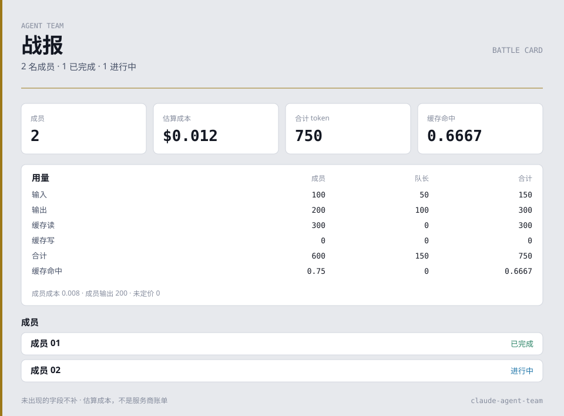

# Integration recipes

These recipes use the local board and standard-library tools. Interactive Codex rollout ingestion is documented separately in [Codex sessions](CODEX_SESSIONS.md); the exec adapter below is a different offline format. See [the main guide](GUIDE.md) for board setup and [the Codex maintainer guide](CODEX.md) for using Codex to maintain this repository. No hosted service is added.

## Optional Claude Code hook channel

`python install.py --hooks` registers a local command hook. It does not replace hooks you already configured. The relay posts a short JSON event to `POST /api/hooks/event` on `127.0.0.1`. The snapshot field `live` still lists the raw events for the selected session. `live.merged` is true when that list has been joined into `feed`: one tool call is one row. The preferred key is `session_id + tool_use_id` (`live.correlate` stays `tool_use_id`). With no id, the key is tool name, a 5 second window, and a short hash of the tool input. Estimated cost still comes only from the transcript. Full field list, failure behavior, and uninstall notes are in [HOOKS.md](HOOKS.md).

## Optional loopback snapshot events

`GET /events` and `GET /api/events` are the same Server-Sent Events stream. The board still binds only `127.0.0.1`. A browser `Origin` must be that loopback host plus this server's port. A local client with no `Origin` (curl, the tests) may connect. The query string matches `/snapshot.json`: `source`, `session`, `project` or `cwd`.

The first message is `hello`. Later `refresh` messages fire when the selected session changes in a way the board treats as meaningful: activity, status, cost, tasks, stall-alert threshold, or the live hook feed. Clock-only fields (snapshot time, task age, idle seconds that have not crossed the stall threshold) do not by themselves emit `refresh`. About every 12 seconds the server emits `refresh` anyway, so on-screen durations keep moving. Comment lines keep the connection open and do not refresh the page.

Both events carry `rev`, `source`, `session` and `generatedAt`. They do not carry message text, prompts or local paths. The page loads `/snapshot.json` and uses the existing render path. `rev` is a short hash of that same public snapshot with the clock fields removed. If the browser has no `EventSource`, or the stream fails before `hello`, the page keeps polling `/snapshot.json` about every 1.5 seconds and closes the failed stream. If a stream that already delivered `hello` drops, the browser reconnects using the `retry` field (3 seconds) and polling covers the gap. `?demo=1` keeps polling because those extra messages are created in the page. Export, battle-card and retrospective tools keep reading `/snapshot.json` only.

## Codex exec event metrics

The [Codex exec adapter](CODEX_METRICS.md) accepts an explicitly supplied `codex exec --json` log and emits aggregate counts and token usage without text, commands or identifiers:

```sh
python tools/codex_metrics.py --input examples/codex-exec.synthetic.jsonl
```

This command works entirely offline and does not start Codex or spend API credits. Its event-report format is separate from the board snapshot export below. For a no-account UI walkthrough, use the [read-only synthetic demo](DEMO.md).

## Export aggregate metrics

From the repository root, try the entirely synthetic fixture without installing or starting the board:

```sh
python tools/export_snapshot.py --input examples/snapshot.synthetic.json
python tools/export_snapshot.py --input examples/snapshot.synthetic.json --output metrics.json
```

To read an already-running board:

```sh
python tools/export_snapshot.py --port 7788 --output metrics.json
```

When several projects are active, select the source explicitly. The same selectors work with the default JSON output and with `--format prometheus`:

```sh
python tools/export_snapshot.py --port 7788 --session sess-0001 --output metrics.json
python tools/export_snapshot.py --port 7788 --project C--demo --format prometheus --output team.prom
```

`--session` matches a session ID prefix. `--project` prefers an exact project key, otherwise a substring; it selects the most recently active matching session. A session prefix shared by multiple sessions also selects the most recently active match, so use a full ID when you need a unique target. Project keys are the keys shown by the board, not filesystem paths. These mutually exclusive options require `--port`; they cannot filter an offline `--input` file. Omitting them preserves the server's default selection. Browser session selection is independent of this command.

The exporter URL-encodes the selector and verifies the returned session metadata before rendering JSON or Prometheus text. Missing or mismatched session metadata returns 1 and leaves any existing output file unchanged. The file is replaced atomically only after a successful read and render. Selector values remain local to the request and never appear in exported aggregates, Prometheus labels, or fixed error diagnostics. The JSON output schema remains version 1.

Python 3.8+ and its standard library are sufficient. Choose exactly one of `--input` or `--port`. The output directory must already exist. The exporter refuses an output path that resolves to the input file, including an existing hardlink alias. Exit code 0 means success; 1 means a read, validation or write failure; argparse uses 2 for invalid command-line arguments. Error messages omit source data and tracebacks.

The live mode performs one read-only GET to `http://127.0.0.1:<port>/snapshot.json` with an optional encoded `session` or `project` query parameter, bypasses environment/system HTTP proxies, refuses all redirects, and has a five-second socket timeout. Both file and HTTP inputs have an 8 MiB limit. There is no arbitrary remote-URL option or automatic upload.

### Output contract: schemaVersion 1

The exporter constructs a new object from this explicit allowlist:

| Field | Meaning |
| --- | --- |
| `schemaVersion` | Export format version, currently 1 |
| `memberCount` | Number of member entries in the selected board snapshot; excludes the lead |
| `totals.cost` | Estimated USD cost for lead and members |
| `totals.membersCost` | Estimated USD cost for members only |
| `totals.unpriced` | Count of lead/member entries with no configured price |
| `totals.tokens` | Member output tokens (not all tokens) |
| `totals.usage` | Aggregate member usage |
| `totals.leadUsage` | Aggregate lead usage |
| `totals.allUsage` | Combined lead and member usage |

Each usage object contains only `in`, `out`, `cache_read`, `cache_write`, `total`, and `cacheHit`. Token/count values must be nonnegative integers; costs must be finite nonnegative numbers; `cacheHit` must be between 0 and 1. Booleans are not accepted as numbers. Costs use the board's configured estimates, not provider invoices. With unpriced models, cost is a partial estimate; check `unpriced` before interpreting it.

The source board JSON is an internal interface that can evolve. The exporter validates the fields it needs and rejects unsupported shapes rather than silently returning zero metrics. Unknown source fields are ignored. Consumers should depend on the versioned exporter output and test against `examples/snapshot.synthetic.json`, rather than copy the board's raw snapshot schema.

## Prometheus and node_exporter

The same exporter supports the [Prometheus text format](https://prometheus.io/docs/instrumenting/exposition_formats/) with `--format prometheus`. Python 3.8+ standard-library modules are sufficient; Prometheus and node_exporter are optional consumers installed separately. JSON remains the default.

Try the entire conversion offline, without an account or a running board:

```sh
python tools/export_snapshot.py --input examples/snapshot.synthetic.json --format prometheus
python tools/export_snapshot.py --input examples/snapshot.synthetic.json --format prometheus --output team.prom
```

Compare the output with [`examples/prometheus.synthetic.prom`](../examples/prometheus.synthetic.prom). The fixture contains five metric families and 22 samples, all derived from the existing synthetic snapshot. That fixture has no session budget, so it does not include `claude_agent_team_budget_utilization_ratio`. The series appears only when `budget.enabled` is true and `budget.ratio` is a finite nonnegative number (known spend divided by the session cap, which may exceed 1). It is not part of the JSON schemaVersion 1 object. The same fixture has no parsed test result, so it also omits `claude_agent_team_test_results`. That family appears only when at least one member `lastTest.status` is `pass`, `fail` or `unknown`. Task copies are not counted again. It is not part of the JSON schemaVersion 1 object.

### Metric contract

| Metric | Labels | Meaning |
| --- | --- | --- |
| `claude_agent_team_members` | none | Number of member entries; excludes the lead |
| `claude_agent_team_estimated_cost_usd` | `scope="all"` or `"members"` | Estimated USD cost; partial when entries are unpriced |
| `claude_agent_team_unpriced_entries` | none | Lead/member entries without a configured price |
| `claude_agent_team_tokens` | `scope="members"`, `"lead"`, `"all"`; `kind="input"`, `"output"`, `"cache_read"`, `"cache_write"`, `"total"` | Board-reported token buckets for each scope |
| `claude_agent_team_cache_hit_ratio` | `scope="members"`, `"lead"`, `"all"` | Board-reported cache hit ratio between 0 and 1 |
| `claude_agent_team_budget_utilization_ratio` | `scope="session"` | Optional. Known session spend divided by the configured USD cap. Omitted when no session cap is set. May exceed 1 |
| `claude_agent_team_test_results` | `status="pass"`, `"fail"` or `"unknown"` | Optional. Latest parsed test per member. Omitted when no member has one of those statuses. Counts can fall when the selection changes |

Every family includes `HELP` and `TYPE` metadata. **All metrics are gauges** for the board's currently selected session, not lifetime counters: selecting another session or revising prices may lower a value. Use direct gauge queries, not `rate()` or `increase()`. Scopes overlap (`all` includes lead and members), and token `total` overlaps its component buckets. Select one scope and kind rather than summing across every sample. Costs are estimates, not provider invoices.

Live mode reads one session through `/snapshot.json`. Without `--session` or `--project`, that is the server's default session, usually the most recent one unless the board was started with a session or project filter. To publish a different project as a Prometheus textfile:

```sh
python tools/export_snapshot.py --port 7788 --project C--demo --format prometheus --output team.prom
```

Changing the browser's session selector does not change this command's source. The output is one selected session, not an aggregate of every session. Use an explicit offline snapshot when you need to control the source independently of the live server.

The format has fixed metric names and fixed label values. No session IDs, member/model names, paths, messages or raw errors become labels or help text. There are no per-sample timestamps. The file and live input modes retain the JSON exporter's 8 MiB limit, validation, proxy bypass and redirect refusal. Prometheus samples must also fit a finite float64 value; excessively large JSON integers are rejected. Counts above float64's exact integer precision can be rounded by the monitoring system.

### Collect a local board through node_exporter

On a host with an existing [node_exporter textfile collector](https://github.com/prometheus/node_exporter#textfile-collector), create a writable collector directory accessible to the account that runs the exporter command and readable by node_exporter. For a local trial, run both commands as the same account in separate terminals:

```sh
mkdir -p /tmp/team-metrics
# From the repository root, with the board already running.
# Omit --project to keep the server's default session.
python tools/export_snapshot.py --port 7788 --project C--demo --format prometheus --output /tmp/team-metrics/claude_agent_team.prom
```

```sh
node_exporter --web.listen-address=127.0.0.1:9100 --collector.textfile.directory=/tmp/team-metrics
```

Have the existing Prometheus installation scrape that node_exporter. For Prometheus on the same host, merge this job into its `scrape_configs`:

```yaml
scrape_configs:
  - job_name: claude-agent-team
    static_configs:
      - targets: ['127.0.0.1:9100']
```

This is a one-shot export. Run the Python command on your own schedule (for example, every minute using cron or a systemd timer). No scheduler, listener, monitoring service or upload is installed by this project. Keep the board bound to loopback; Prometheus reads node_exporter, not the board's private snapshot endpoint. Existing collectors expose other host metrics as well; configure their access according to your monitoring setup.

Both output formats write a complete UTF-8/LF file to a temporary `.tmp` file in the destination directory, then replace the target atomically. The temporary name does not match node_exporter's `*.prom` glob. The destination directory must exist. A failed read, selector check, validation, write or replacement returns 1 and leaves existing output intact. A selector miss does not create or replace the output file. The command refuses an output that aliases the input, including hardlinks. New output files use private temporary-file permissions; on POSIX, replacing an existing file preserves its permission bits. For a separate collector service account, provision the file/directory permissions or ACLs before scheduling exports; do not assume the new file is world-readable.

Because a failed refresh leaves the last successful file in place, monitor job exit status and file freshness. The collector's `node_textfile_mtime_seconds` exposes the last successful replacement. Example PromQL for Grafana or Prometheus:

```promql
claude_agent_team_estimated_cost_usd{scope="all"}
claude_agent_team_tokens{scope="all",kind="output"}
claude_agent_team_budget_utilization_ratio{scope="session"} > 0.8
claude_agent_team_unpriced_entries > 0
time() - node_textfile_mtime_seconds{file=~".*claude_agent_team[.]prom"} > 120
absent(node_textfile_mtime_seconds{file=~".*claude_agent_team[.]prom"})
```

The last two expressions catch stale files and missing first exports, respectively. Match the filename and refresh interval to your setup; a working query is not an installed alert rule. The CLI works on Windows too, but this node_exporter recipe is for its supported host platforms. No Windows monitoring-agent integration is claimed here.

### Privacy boundary

Exported JSON and Prometheus samples contain numeric aggregates only; Prometheus labels come from fixed scope/kind enums. The optional budget gauge adds only `scope="session"`. The optional test gauge adds only `status="pass"`, `"fail"` or `"unknown"`. Session IDs, timestamps, local paths, member names, prompts, tool arguments, commands, test output, messages, model names and raw errors are excluded, including unknown nested fields added to `totals`. Aggregate activity and estimated spending may still be sensitive: inspect the metrics before sharing them. Raw snapshots and transcripts remain private and should not be attached to public issues.

## Battle card

Render one self-contained SVG from the synthetic fixture, or from a board that is already running:

```sh
python tools/battle_card.py --input examples/snapshot.synthetic.json --static --output card.svg
python tools/battle_card.py --port 7788 --theme dark --output card.svg
python tools/battle_card.py --port 7788 --session sess-0001 --static --output card.svg
python tools/battle_card.py --port 7788 --project C--demo --output card.svg
```

Choose exactly one of `--input` or `--port`. `--session` and `--project` are the same mutually exclusive selectors as [aggregate export](#export-aggregate-metrics): they require `--port`, cannot filter an offline file, and never appear on the card. The port mode performs one read-only GET to `http://127.0.0.1:<port>/snapshot.json` through `export_snapshot.read_snapshot`: proxies are bypassed, redirects are refused, the socket timeout is five seconds, and the body limit is 8 MiB. There is no arbitrary remote URL and no upload.

`--theme auto` (the default) follows `prefers-color-scheme`. `light` and `dark` bake a single palette into the presentation attributes, so the card still has color if a viewer drops the stylesheet. `--static` omits the slow dash. The file names system fonts only. It has no script, no external image and no `foreignObject`.

The card draws a section only when the snapshot already has that data:

| On the snapshot | On the card |
| --- | --- |
| `totals` with every field the aggregate export requires, plus a `members` array | Member count, estimated cost, combined tokens, cache hit, and the usage table. The figures are the `export_metrics` values. |
| `totals.unpriced` greater than zero | The cost is marked 部分. Missing prices are not drawn as zero. |
| Member `name`, `roleTitle` or `agentType`, `dept`, `status`, `cost`, `totalTokens`, `cacheHit`, `toolCount` | One row. A member with no safe name is labeled by position, such as 成员 01. |
| Both `startedAt` and `endedAt` | Elapsed time. A missing end is not replaced with the current time. |
| `departments` | A row when that department has people, an active status, or a non-zero figure. Ids inside `members` are counted, not printed. |
| `officialTeam.tasks` whose `normalizedStatus` (or `status`, when the normalized field is absent) is `completed` | Subject and owner. Task descriptions are not printed. Other statuses are not listed. |
| `stallAlerts.thresholdSec` and `stallAlerts.candidates` | How many idle, errored, or stalled candidates have `idleSeconds` at least the threshold. Names, ids, and error text are not printed. A missing or unusable block is omitted; the card does not time members itself. |
| `theaters` array | How many theater objects are present. Labels, branches, and session ids are not printed. |
| `live.available` true and integer `live.retained` | That retained hook-event count, when it is greater than zero. Event bodies are not printed. |
| `budget.enabled` true and a finite nonnegative `budget.ratio` | A budget-utilization row: the percent, a bar that stops at full width above 100%, and 预算内 / 接近预算 / 超出预算 when `status` is one of `ok`, `warn`, or `over`. A true `lowerBound` adds the fixed words 成本为下限. Names, suggestions, and `lowerBoundLabel` are not printed. |

Sections with nothing to show are omitted. The SVG does not include session ids, local paths, e-mail addresses, prompts, tool arguments, message bodies or model ids. Cost is the board's estimate, not a provider invoice. [`docs/img/battle-card.svg`](img/battle-card.svg) is this command with `--static` on `examples/snapshot.synthetic.json`.



The board button「导出战报卡」builds the same SVG in the browser from the snapshot the page already holds, then downloads `battle-card.svg`. Nothing is uploaded. It follows the page theme, and it omits motion when the browser requests reduced motion.

Exit code 0 means the SVG was written. Exit code 1 is a read, validation or write failure. Argparse uses 2 for invalid arguments. Diagnostics omit source values and tracebacks. The output path must not be the input file.

## Offline replay

Write one self-contained HTML file from a snapshot. Open that file in a browser. It does not start the board, load a CDN, or call an API. The embedded document is a desensitized copy: member cards, tool-timeline labels, and key messages that were already on the snapshot. Aggregate totals are included only when `export_metrics` accepts the snapshot. Missing sections are omitted.

```sh
python tools/export_replay.py --demo -o /tmp/replay.html
python tools/export_replay.py --input examples/board-demo.synthetic.json -o replay.html
python tools/export_replay.py --port 7788 --session sess-0001 -o replay.html
```

`--demo` reads [`examples/board-demo.synthetic.json`](../examples/board-demo.synthetic.json). `--session` and `--project` are the same selectors as [aggregate export](#export-aggregate-metrics): they require `--port` and cannot filter an offline file. The page replays the sanitized timeline with a play control. It does not upload the file.

Absolute home paths, e-mail addresses, API-key-like strings, session ids, prompts, and tool arguments are removed before the file is written. Message text and tool labels that remain are clipped. Read the file before sharing a replay of a real session. The synthetic demo is the happy path; it is not a usage benchmark.

Exit code 0 means the HTML was written. Exit code 1 is a read or write failure. Argparse uses 2 for invalid arguments. Diagnostics omit source values and tracebacks. The output path must not be the input file.

## Team retrospective

Write a Markdown retrospective from the synthetic demo snapshot, an offline file, or a board that is already running:

```sh
python tools/retro_report.py --demo
python tools/retro_report.py --input examples/board-demo.synthetic.json --output retro.md
python tools/retro_report.py --port 7788 --output retro.md
python tools/retro_report.py --port 7788 --session sess-0001 --output retro.md
python tools/retro_report.py --port 7788 --project C--demo --output retro.md
```

`--demo` reads `examples/board-demo.synthetic.json`. Otherwise choose exactly one of `--input` or `--port`. `--session` and `--project` are the same mutually exclusive selectors as [aggregate export](#export-aggregate-metrics): they require `--port` and cannot filter an offline file. The port mode is one read-only GET through `export_snapshot.read_snapshot`. There is no arbitrary remote URL and no upload. The output path must not be the input file.

The report copies fields that are already on the snapshot:

| On the snapshot | In the report |
| --- | --- |
| `startedAt`, `endedAt`, `lastActivityAt`, session `mtime` or `lastActivity` | A timeline row. Duration is filled only when both start and end are present. A missing end is not replaced with the current time. |
| `totals`, department `cost` / `tokens`, member `cost` / `totalTokens` | Those numbers, under 快照总量, 按部门 and 按成员. Rows are not added together. |
| `cost: null` | 未知. It is not drawn as zero. |
| `unpriced` greater than zero on that same object | The numeric cost is marked 部分. |
| Member `status` of `stalled` or `error`, `stallAlerts` idle seconds, `officialTeam.tasks[].blocked` true, timeline `error: true`, `lastTest.status` of `fail` | A blockers section. `blocked: false` is not treated as blocked. |
| `lastTest.status` of `unknown`, `budget.status` of `warn` or `over`, `budget.ratio`, `cacheHit` below 0.2 with a positive token count on the same object, `missing: true` | One suggestion that cites those fields. The 0.2 line is the report's own reference, not a snapshot field, and it is not turned into a savings estimate. |

Sections with nothing to show are omitted. Session ids, local paths, e-mail addresses, prompts, tool arguments and message bodies are left out. Cost is the board's estimate, not a provider invoice.

Exit code 0 means the Markdown was written. Exit code 1 is a read or write failure. Argparse uses 2 for invalid arguments. Diagnostics omit source values and tracebacks.

## OTLP JSON file

`tools/export_otel.py` writes one snapshot as an OTLP/JSON trace file. The process is offline: it does not POST the file, open a collector, or add a runtime dependency. Python 3.8+ and the standard library are enough. Langfuse and Phoenix can ingest that file later, with a command you run yourself.

```sh
python tools/export_otel.py --demo
python tools/export_otel.py --input examples/otel-snapshot.synthetic.json --output traces.json
python tools/export_otel.py --input examples/board-demo.synthetic.json -o traces.json
python tools/export_otel.py --port 7788 --session sess-0001 -o traces.json
python tools/export_otel.py --port 7788 --project C--demo -o traces.json
```

`--demo` reads [`examples/board-demo.synthetic.json`](../examples/board-demo.synthetic.json). Otherwise choose exactly one of `--input` or `--port`. `--session` and `--project` are the same mutually exclusive selectors as [aggregate export](#export-aggregate-metrics): they require `--port` and cannot filter an offline file. The port mode is one read-only GET through `export_snapshot.read_snapshot` (loopback only, proxies bypassed, redirects refused, five-second timeout, 8 MiB limit). There is no arbitrary remote URL. The output path must not be the input file. Exit code 0 means the file was written. Exit code 1 is a read, validation, or write failure. Argparse uses 2 for invalid arguments. Diagnostics omit source values and tracebacks.

[`examples/otel-export.synthetic.json`](../examples/otel-export.synthetic.json) is the output of the second command. It is synthetic. The open member's cost (`1.25`) is not in that file: that member has no `endedAt`, and the exporter does not invent a span to hold the number.

### OTLP/JSON subset

The document is a subset of [`ExportTraceServiceRequest`](https://github.com/open-telemetry/opentelemetry-proto/blob/main/opentelemetry/proto/collector/trace/v1/trace_service.proto) in the [OTLP/JSON protobuf encoding](https://opentelemetry.io/docs/specs/otlp/#json-protobuf-encoding). Keys are lowerCamelCase. `traceId` and `spanId` are lowercase hex, not base64. `kind` and `status.code` are integers, not enum names. `fixed64` and `int64` values are decimal strings.

Implemented:

| JSON | What is written |
| --- | --- |
| `resourceSpans[].resource.attributes[]` | `key` plus one of `stringValue`, `boolValue`, `intValue`, `doubleValue` |
| `resourceSpans[].scopeSpans[].scope` | `name` `team-board.export_otel`, `version` `1` |
| `spans[].traceId` | 32 lowercase hex characters, not all zeros. One id for the whole file |
| `spans[].spanId` | 16 lowercase hex characters, not all zeros |
| `spans[].parentSpanId` | Omitted for a root. Otherwise the `spanId` of another span in this file |
| `spans[].name` | Redacted label, or a fixed fallback such as `lead`, `member`, `event`, `hook` |
| `spans[].kind` | Integer `1` (`SPAN_KIND_INTERNAL`) only |
| `spans[].startTimeUnixNano`, `endTimeUnixNano` | Decimal strings of unix nanoseconds. `end` is greater than or equal to `start` |
| `spans[].attributes[]` | The same KeyValue shape as resource attributes. `intValue` is a decimal string |
| `spans[].status.code` | Integer `1` (OK) or `2` (ERROR). Omitted when the snapshot does not say. No `status.message` |

Not implemented: `resourceLogs`, metrics, `schemaUrl`, dropped-count fields, `flags`, `traceState`, span events, links, `arrayValue`, `kvlistValue`, `bytesValue`, gRPC, and protobuf. Attribute keys `gen_ai.*` and `langfuse.*` are not set. Receivers that ignore unknown fields can still read this document; a receiver that requires those missing fields will not get them from this file.

Resource attributes that are always present:

| Key | Value |
| --- | --- |
| `service.name` | `claude-agent-team`. This identifies the exporter. It is not read from the snapshot |
| `team.export.schema` | `1` |
| `team.export.signal` | `traces` |

Copied only when the snapshot already has a usable value:

| Key | Source |
| --- | --- |
| `service.version` | `version`, when it is a short string with no path, email, or key material |
| `team.snapshot.demo` | `demo`, when it is a boolean |
| `team.snapshot.generated_at_unix_nano` | `generatedAt`, when it is whole unix seconds. A decimal string, not an `intValue`, because OTLP integer attributes are signed and a nanosecond timestamp can exceed that range |
| `team.member_count`, `team.totals.cost`, `team.totals.members_cost`, `team.totals.unpriced`, `team.totals.output_tokens` | `export_metrics`. `output_tokens` is the aggregate field `totals.tokens` (member output tokens). The numbers are copied, not added up again |
| `team.usage.{members,lead,all}.{input,output,cache_read,cache_write,total,cache_hit}` | `totals.usage`, `totals.leadUsage`, and `totals.allUsage`. `input` is `in` and `output` is `out` |
| `team.budget.utilization_ratio` | `budget.ratio` when `budget.enabled` is true and the ratio is a finite nonnegative number. It may be greater than 1. An invalid ratio is omitted. Names and suggestion text are omitted |
| `team.export.omitted_spans` | How many candidate spans were dropped by the cap of 400. Omitted when nothing was dropped |

If `export_metrics` rejects the snapshot, the totals and usage attributes are left out together. They are not filled with zeros.

### Which snapshot objects become spans

A candidate without a usable timestamp is skipped. Department rows are not spans. The cap keeps at most 400 spans, in this order: closed actors (lead, then members), activity, comms, tasks, then live hooks. Inside each group after the actors, order is timestamp, then the original order.

| Snapshot object | Span |
| --- | --- |
| Lead or member with both `startedAt` and `endedAt` as whole unix seconds, and `endedAt` greater than or equal to `startedAt` | One root span. `team.actor.kind` is `lead` or `member`. Cost, `unpriced`, token counters, `cacheHit`, `toolCount`, status, department, and role are copied when those fields are usable. `cost: null`, a negative cost, or a non-number is omitted, not written as 0. `team.cost.partial` is true only when that same object has `unpriced` greater than 0 and a numeric cost was copied |
| Lead or member with a null or missing `endedAt` | No actor span. The exporter does not use the current time, and it does not turn the start into a zero-length span. That actor's cost stays only inside the aggregate totals, when `export_metrics` accepted them |
| `feed` item with `ts` | One span. When `feed` is an array, timelines are not also exported, including when that array is empty. When `feed` is missing or not an array, each lead and member `timeline` is used instead |
| `ms` on that activity item | End time is `ts` plus that many milliseconds, when `ms` is a nonnegative integer that still fits in a uint64. Any other `ms` leaves the end equal to the start. A missing `ms` also leaves the end equal to the start, because the snapshot has only one timestamp |
| `comms` item with `ts` | One instant span. `fromName`, `toName`, `kind`, and redacted `text` are copied when safe. `from` and `to` ids are not |
| `officialTeam.tasks` item with `stateSince` | One instant span at `stateSince`. Subject, status, `blocked`, and owner are copied when safe. The description and dependency ids are not. `stateSeconds` is not added onto the end |
| `live.events` item with `ts`, and `live.merged` is not true | One instant span. `session_id`, `tool_use_id`, and `agent_id` are not written. `agent_id` or a feed `memberId` may select a display name that is already on the lead or a member; the id itself is not written. When `live.merged` is true the events are skipped, because the board has already joined them into the feed |

An activity, comm, task, or hook span becomes a child of the first closed actor with the same public name when the event start falls inside that actor's interval, including both ends. Actor spans stay roots. The first match wins, lead before members.

`status.code` is `2` when an actor's `status` is `error`, an event's `error` is true, a copied test `status` is `fail`, or a comm `kind` is `error`. It is `1` when an actor's `status` is `completed` or `finished`, a test `status` is `pass`, or an event has `done: true` and `error: false` and the test status is not `unknown`. A test status of `unknown` leaves the code unset. Tasks and hooks do not get a status code.

Test counters (`passed`, `failed`, `skipped`, `errors`, `exitCode`) are copied only when they are nonnegative integers. `null` stays omitted. `framework` must be a short token and must not itself look like a key or a path.

Ids are a SHA-256 prefix of the redacted span contents. They are not session ids. The same snapshot produces the same ids. Re-running does not allocate new ones.

### Privacy

Home paths (`/home`, `/Users`, `C:\Users`, `D:/Users`, a `~/` path), e-mail addresses, and API-key-shaped strings (`sk-`, `ghp_`, `github_pat_`, `xox*`, `AKIA`, `Bearer`, `api_key`, a PEM private key) are replaced or dropped before the file is written. The patterns match [`tools/export_replay.py`](../tools/export_replay.py). A label that still contains a 16+ hex run or a UUID is dropped. Prompts, descriptions, model ids, pet ids, session ids, and tool-use ids are not copied. Message text that remains is redacted and clipped. The writer refuses the file if the serialized JSON still matches that private-data pattern. The refusal does not print the match.

`team.cost.usd` is the board's estimate from the snapshot. It is not a provider invoice and not a price computed by Langfuse or Phoenix.

### Import into Langfuse or Phoenix

This repository does not call either service. The steps below are the OTLP/HTTP JSON requests those projects document. They send the file you already wrote. They need a host you choose, and credentials you supply in that shell. Do not commit those credentials.

Langfuse accepts OTLP over HTTP with JSON or protobuf. gRPC is not accepted. The trace path is `POST /api/public/otel/v1/traces`, with Basic auth from the project keys and the header `x-langfuse-ingestion-version: 4`. That header and the curl shape are documented in [Get Started with Tracing](https://langfuse.com/docs/observability/get-started) and [OpenTelemetry (OTEL) for LLM Observability](https://langfuse.com/integrations/native/opentelemetry). Point `LANGFUSE_HOST` at the origin for your region or self-hosted deployment (`https://cloud.langfuse.com` for the EU cloud, `https://us.cloud.langfuse.com` for the US cloud, or your own origin).

```sh
curl -X POST "$LANGFUSE_HOST/api/public/otel/v1/traces" \
  -u "$LANGFUSE_PUBLIC_KEY:$LANGFUSE_SECRET_KEY" \
  -H "Content-Type: application/json" \
  -H "x-langfuse-ingestion-version: 4" \
  --data-binary @traces.json
```

This file does not set `gen_ai.*` or `langfuse.*` attributes and does not include a model id, so Langfuse has no model from which to price the span. A `team.cost.usd` attribute is the board estimate that was already on that closed actor. Token counts are the snapshot's own numbers. Unmapped attributes are stored by Langfuse under metadata; see the attribute-mapping section of the same OpenTelemetry page.

Phoenix serves OTLP/HTTP JSON on its UI port, at `http://localhost:6006/v1/traces`, not on the generic OTLP port 4318. See [Exporter and OTLP](https://arize.com/docs/phoenix/tracing/concepts-tracing/otel-openinference/exporter). Phoenix's [Import Existing Traces](https://arize.com/docs/phoenix/tracing/how-to-tracing/importing-and-exporting-traces/importing-existing-traces) page loads a `phoenix.TraceDataset`. That is a different file. Do not pass this OTLP document to `TraceDataset.load`.

```sh
curl -X POST "http://localhost:6006/v1/traces" \
  -H "Content-Type: application/json" \
  --data-binary @traces.json
```

If that Phoenix deployment requires a key, the same exporter page shows `Authorization: Bearer <PHOENIX_API_KEY>`. A local `phoenix serve` without authentication uses the curl above. No live Langfuse or Phoenix response is claimed by this repository; the checked-in sample is the synthetic file, compared in `tests/test_export_otel.py`.

## File-based handoffs from other tools

The existing `team-board/msg.py` can send a handoff to a project inbox without a running board:

```sh
# Run from your project directory after creating .team/inbox/.
python /path/to/claude-agent-team/team-board/msg.py send lead "Tests passed; review the local patch." --from contributor
python /path/to/claude-agent-team/team-board/msg.py inbox lead
```

The CLI searches the current directory and parents for `.team/inbox/`. When the local board cannot be reached, `send` appends a Markdown entry; `inbox` reads the local inbox. With a running board it uses the existing message bus. This shares a handoff, not a session import, and does not cause an external coding tool to execute it automatically. Treat received content as untrusted data and review commands before running them.

To contribute a new adapter, use synthetic fixtures, preserve the read-only/privacy boundary, and describe compatibility limits in your PR. See [CONTRIBUTING.md](../CONTRIBUTING.md).
